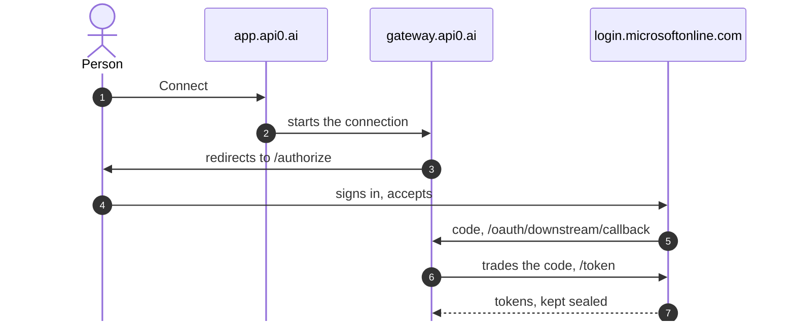

# Azure DevOps in Claude, Each Person With Their Own Microsoft Account

By the end of this guide, you ask Claude to "create a bug 'Login fails on Safari' and assign it to me", and the work item shows up in Azure DevOps **under your name**, with **your** permissions. Nobody pastes a token: each person clicks **Connect** once and signs in with their Microsoft account. After that, api0 renews access on its own.

Allow an hour, errors included. For the same thing in Teams, continue with [the Teams guide](/guides/your-api-in-teams) (guide 07).

Throughout the guide, replace:

| Placeholder | What it is | Where to find it |
|---|---|---|
| `<tenant-id>` | Your Microsoft directory (Entra ID) ID | Entra admin center → **Overview** → *Tenant ID* |
| `<organization>` | Your Azure DevOps organization name | `dev.azure.com/<organization>` |
| `<project>` | A project in that organization | `dev.azure.com/<organization>/<project>` |
| `<client-id>` | The ID of the Entra app created in step 2 | The app's **Overview** page |

## How it works

api0 never holds anyone's Microsoft password, only each person's token, which Entra ID issues and api0 keeps sealed. Once per person, **Connect**:



- **1–3.** **Connect** sends the person to `login.microsoftonline.com/<tenant-id>/oauth2/v2.0/authorize`. If it breaks: step 5.
- **4.** They sign in with their **work account** and accept. If it breaks: consent, step 3.
- **5.** Entra ID returns a code to `gateway.api0.ai/oauth/downstream/callback`. If it breaks: the redirect URI, step 2.
- **6–7.** The gateway trades the code and keeps the tokens sealed. If it breaks: the app's secret, step 2.

After that, on every request in Claude, the gateway renews the person's token if it expired, without asking them, and calls `dev.azure.com/<organization>` with it. Azure DevOps therefore creates the work item in their name and with their rights. Without project access, Azure DevOps refuses, and api0 grants nothing on top. The full path of a request and all of api0's domains are in guide 04.

Two kinds of Microsoft account are involved. Keep them apart:

| Account | Role |
|---|---|
| **Directory administrator** | Creates the Entra app and grants consent (steps 2 and 3). **Never use it for Connect**: see step 5. |
| **Work account** | What each person uses for Connect and Azure DevOps. A plain user: **Basic** access in Azure DevOps, and **no admin role**. |

## 1. An Azure DevOps organization on the right directory

The organization must be connected to **the same Entra directory** as the app you'll create in step 2. That directory is the one that issues the tokens.

Check it in **Organization settings → Microsoft Entra**: the directory shown must be `<tenant-id>`.

To create an organization on that directory:

1. Open a **private window** and go to `https://aex.dev.azure.com/me`.
2. Sign in with an account from that directory.
3. In the directory drop-down, pick the one whose ID is `<tenant-id>`.
4. **Create new organization**, then a project. Choose the **Agile** process if you want a **Bug** type: the **Basic** process only has Epic, Issue, Task and Test Case, so there you ask for an **Issue**.

> **Error `TF400813: The user is not authorized to access this resource. The user is not a member of the AAD directory that the target Organization is connected to.`**
> The browser was signed in with another account (a personal one, or one from another directory), and Azure DevOps picked the wrong directory. The private window and explicitly choosing the directory on `aex.dev.azure.com/me` fix it.

## 2. An Entra app dedicated to api0

Create an app **just for api0**. Don't reuse an existing one (another product's app, or one that accepts personal Microsoft accounts): Azure services only accept work accounts, and you want to be able to revoke api0 without breaking anything else.

In **Entra admin center → Identity → Applications → App registrations → New registration**:

- **Name**: `api0 downstream`
- **Supported account types**: *Accounts in any organizational directory (multitenant)*. Not personal accounts. "Multitenant" lets a customer later consent to the same app in their own directory.
- **Redirect URI**: **Web** platform, `https://gateway.api0.ai/oauth/downstream/callback`

If people will also **sign in to api0** with their Microsoft account, you need a second redirect URI: see the variants below.

Then, in the app:

1. **Certificates & secrets** (left menu, *Manage* section) → **Client secrets** tab → **New client secret**. Copy the **Value** column right away, not the *Secret ID*: it won't be shown again. Keep it for step 4 and don't send it to anyone. If it ever ends up in a chat, an email or a screenshot, delete it and create a new one.
2. **API permissions → Add a permission** → **Azure DevOps** → **Delegated** → `user_impersonation`.

> **Can't find "Certificates & secrets"?** You're probably in **Certificate authorities**, a directory-wide security setting. The secret is created *inside the app*: open **App registrations → All applications → api0 downstream**, and the menu appears on the left.

## 3. Admin consent

Still in **API permissions**, click **Grant admin consent for \<your directory\>**. The permissions should turn green, *Granted*.

> **Error `Could not grant admin consent. Your organization does not have a subscription (or service principal) for the following API(s): …`**
> A directory created for something else (licensing, for instance) may not have the local entry (the *service principal*) for Microsoft's services. Create them with Azure CLI:
>
> ```bash
> az login --tenant <tenant-id> --allow-no-subscriptions
> ```
>
> ```bash
> az ad sp create --id 499b84ac-1321-427f-aa17-267ca6975798
> ```
>
> That's Azure DevOps, usually the one missing. If the message also listed Microsoft Graph (`00000003-0000-0000-c000-000000000000`) or Azure Service Management (`797f4846-ba00-4fd7-ba43-dac1f8f63013`), run the same command with their ID. A reply of *"The service principal name … is already in use"* means it **already exists**: nothing to do. Then click **Grant admin consent** again.

## 4. The api0 wizard

The wizard replaces the tenant's **default connection**. If this tenant already calls another API through its default connection, add Azure DevOps as a **named connection** instead (guide 06, section 3.1), with the same values as screen 4 below.

Your api0 account's email has **nothing to do** with the Microsoft account: at **Connect**, Microsoft asks you to sign in, and you pick the account from your directory. An api0 account on Gmail that connects to Azure DevOps as `firstname@your-company.com` works fine.

On [app.api0.ai](https://app.api0.ai), start the setup wizard (offered at first sign-in, or through your tenant's **Reconfigure** button):

1. **Where do your people's work accounts live?**: *Microsoft 365 (Entra ID)*. People then sign in to api0 as themselves, which needs the second redirect URI (see the variants).
2. **Import your API**: download [the Azure DevOps endpoints](https://api0.ai/downloads/azure-devops-endpoints.json), replace every `YOUR-ORGANIZATION` in the file with `<organization>`, and upload it. It lands as an API named **Azure DevOps**, under **Custom API Groups** on the **API** page, where you can edit it like any other API. Its tools reach Claude as `azure-devops-create-work-item`, `azure-devops-query-work-items` and so on. Importing another file later keeps it, unless that file has an API with the same name.
3. **Whose account should the API see?**: *Each person connects their own account*.
4. **Your application in Entra ID**:

| Field | Value |
|---|---|
| Entra directory (tenant) ID | `<tenant-id>` |
| Application (client) ID | `<client-id>`, a GUID like `c481c32b-…` |
| Client secret | the **Value** copied in step 2 |
| Scope | `499b84ac-1321-427f-aa17-267ca6975798/user_impersonation offline_access` |

Two things to watch:

- **Client ID and Client secret are easy to swap.** The client ID is always a GUID (`xxxxxxxx-xxxx-…`). A secret looks like `ofk8Q~…`. If you paste the secret into the Client ID field, Microsoft answers `AADSTS700016` at Connect.
- **The scope isn't optional for Microsoft.** The field's grey text is an example, not a value. An empty scope gives `AADSTS900144`. `499b84ac-…` is Azure DevOps.

5. The last screen tests the connection with a read-only call. **It should fail** with a message along the lines of "you haven't added your access yet": expected, since you haven't connected your account. The configuration is already saved. A **Connect your account** button sits right under the message: it does the same thing as step 5 below.

**Reconfiguring later.** Your tenant's **Reconfigure** button reopens this wizard with the saved values filled in. Secrets are never shown back: paste a new one, or leave the field empty if it says it's saved, and the stored one is kept.

## 5. Connect

In **Settings → My access tokens** (or directly `app.api0.ai/?view=settings`), your tenant shows **Not connected** and a **Connect** button:

1. Click **Connect**.
2. Microsoft asks you to sign in: pick your work account from the `<tenant-id>` directory.
3. You land back on api0 with **Your account is connected**.

Once connected, the button becomes **Reconnect**: use it to sign in again, or to switch to another work account.

If Microsoft shows an error page, come back to api0 with **reload**, not just the browser's Back button: a page restored by Back may keep its buttons greyed out.

**Never with an account that holds an admin role.** On a directory with *Security defaults* (on by default in new directories), administrators must use multi-factor sign-in. api0 renews tokens in the background, where nobody can answer a multi-factor prompt, so Microsoft refuses the renewal. **Connect** therefore refuses an account that holds any directory role beyond an ordinary user's, and says so on **My access tokens**. If an account is given an admin role after connecting, the next renewal fails: the Entra sign-in log (**Monitoring & health → Sign-in logs → User sign-ins (non-interactive)**) shows the attempt as **Interrupted**, and the bot or the tool says so. Fix: remove the admin roles, then **Reconnect**. Do the administration with a separate account.

**The account must have opened Azure DevOps once.** Azure DevOps refuses API calls from an account that has never signed in to its website. The check then answers HTTP 403, and the reply's title says *"Identity … has not been materialized, please use interactive login over the browser first"*. Open `https://dev.azure.com/<organization>` once in a browser with that account, then run the check again.

**Still the same 403 after opening Azure DevOps?** You probably connected with a personal Microsoft account invited into the directory. In **Entra admin center → Users**, its user principal name looks like `firstname_domain#EXT#@<directory>.onmicrosoft.com` (search for the ID quoted in the error). Connect gets a token for that directory identity, while dev.azure.com signs you in as the personal account itself, so Azure DevOps never meets the identity in the token. **Connect** again with a real work account from the directory (**Use another account** on Microsoft's account picker). If the directory has none yet, the appendix shows how to create one.

## 6. Try it, then open it to others

Add the tenant's connector in Claude as described in the [main guide](/guides/your-api-in-claude), then ask for example:

```
Create an issue "Login fails on Safari" in project <project> and assign it to firstname@your-company.com
```

Open `https://dev.azure.com/<organization>/<project>/_workitems/recent`: the work item is there, **Created By** your work account.

**Name the assignee with the work email.** api0 knows you by your api0 email, which Azure DevOps doesn't know, so it can't work out "me".

If the reply says the type doesn't exist, your project uses the Basic process: ask for an **Issue** instead of a **Bug**.

Each new person, with no admin rights:

1. Their administrator adds them to Azure DevOps (**Basic**, project group **Contributors**).
2. They open `https://dev.azure.com/<organization>` once in a browser, so Azure DevOps knows them.
3. They sign in to `app.api0.ai` (or follow the tenant's **Get started** page), then **Settings → My access tokens → Connect**, with their work account.

They can only do what their own Azure DevOps permissions allow, and what they create is attributed to them, never to someone else.

For Teams: [the Teams guide](/guides/your-api-in-teams) (guide 07). The bot uses the same connection, and each person links their account there once.

## Variants

**People sign in to api0 with their Microsoft account.** That's the *Microsoft 365 (Entra ID)* option on screen 1 of the wizard. The same Entra app handles it: in **Authentication**, add a second Web redirect URI, `https://gateway.api0.ai/oauth/idp/callback`. One app, two redirect URIs, one secret.

**People sign in to api0 with their api0 account.** On screen 1 choose *Neither*. On screen 3 choose *Someone else's service*, then *Other options* and *Each person connects their own account*. Screen 4 then also asks for the authorization endpoint `https://login.microsoftonline.com/<tenant-id>/oauth2/v2.0/authorize` and the token endpoint `https://login.microsoftonline.com/<tenant-id>/oauth2/v2.0/token`. The scope must still include `offline_access`.

**Tools that also read your Azure subscription** (resources, costs). Add the delegated **Azure Service Management** → `user_impersonation` permission in step 2, and give those tools their own named connection, with the scope `https://management.azure.com/user_impersonation offline_access`: an Azure DevOps token isn't valid for Azure Resource Manager (guide 06, section 3).

## Appendix: a work account in a test directory

A directory opened from a personal Microsoft account (common for an Azure subscription created for something else) often has no native work account. To create one:

1. **Entra admin center → Users → New user → Create new user**, for example `demo@<directory>.onmicrosoft.com`. No admin role.
2. **Azure DevOps → Organization settings → Users → Add users**: that account, access level **Basic**, project `<project>`, group **Project Contributors**.
3. In a private window, open `https://dev.azure.com/<organization>/<project>` as that account and set its password.
4. In api0, **Connect** again. On Microsoft's account picker, choose **Use another account** and sign in with that account.

Keep the personal account for administration (steps 2 and 3), and this one for Connect, Azure DevOps and Teams.

## Error recap

| Message | Cause | Fix |
|---|---|---|
| `TF400813 … not a member of the AAD directory` | Wrong account or directory in the browser | Private window, `aex.dev.azure.com/me`, pick the directory |
| No "Certificates & secrets" | You're in *Certificate authorities* | Open the app itself under *App registrations* |
| `Could not grant admin consent … no service principal` | The directory lacks the local entry for a Microsoft service | `az ad sp create --id <service ID>`, then consent again |
| `… is already in use` when creating a service principal | It already exists | Nothing to do |
| The wizard's final test fails | You haven't clicked Connect yet | **Connect your account**, or Settings → My access tokens → Connect |
| `AADSTS700016: Application with identifier '…' was not found` | The Client ID field holds something else, often the secret | Client ID = the app's GUID; create a new secret if the old one was exposed |
| `AADSTS900144: The request body must contain the following parameter: 'scope'` | Empty scope | `499b84ac-1321-427f-aa17-267ca6975798/user_impersonation offline_access` |
| `AADSTS50011` (redirect URI mismatch) | The app lacks the api0 redirect URI | Add `…/oauth/downstream/callback` (and `…/oauth/idp/callback` for Microsoft sign-in) as **Web** |
| HTTP 403, `Identity … has not been materialized, please use interactive login over the browser first` | The account has never opened Azure DevOps in a browser | Open `dev.azure.com/<organization>` once with that account, then check again |
| The same 403, even after opening Azure DevOps | The token is for a personal account's `#EXT#` identity in the directory | Connect again with a native work account (appendix) |
| Wizard buttons greyed out after coming back from Microsoft | Page restored by the browser's Back | Reload the page |
| Access "not set up, or has expired" the day after Connect; gateway log `invalid_grant`; Entra sign-in log **Interrupted** | The connected account was given an admin role and must use multi-factor sign-in, which a background renewal can't do | Remove the admin roles, then **Reconnect** |
| `Work item type Bug does not exist in project` | The project uses the Basic process | Ask for an **Issue**, or use an Agile project |
