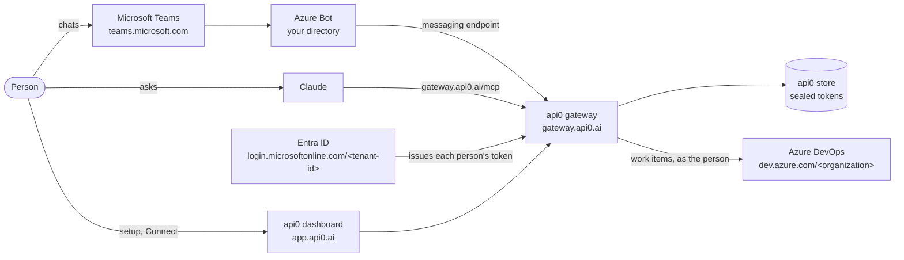

# Azure DevOps in Claude and Teams, Each Person With Their Own Microsoft Account

By the end of this guide, you ask Claude or Teams to "create a bug 'Login fails on Safari' and assign it to me", and the work item shows up in Azure DevOps **under your name**, with **your** permissions. Nobody pastes a token: each person clicks **Connect** once and signs in with their Microsoft account. After that, api0 renews access on its own.

Almost all of this is free: Azure DevOps is free for up to 5 users (Boards included), the Entra app and the Azure Bot cost nothing. The only paid piece is Teams itself, if your directory doesn't have it yet; a one-month trial covers a demo. Allow an hour for Azure DevOps and another for Teams, errors included.

Throughout the guide, replace:

| Placeholder | What it is | Where to find it |
|---|---|---|
| `<tenant-id>` | Your Microsoft directory (Entra ID) ID | Entra admin center → **Overview** → *Tenant ID* |
| `<organization>` | Your Azure DevOps organization name | `dev.azure.com/<organization>` |
| `<project>` | A project in that organization | `dev.azure.com/<organization>/<project>` |
| `<client-id>` | The ID of the Entra app created in step 2 | The app's **Overview** page |

## The systems involved

Five systems take part. api0 sits in the middle: it never holds anyone's Microsoft password, only each person's token, which Entra ID issues.



The same picture as plain text, for places that don't draw diagrams:

```
 Person ── Teams ── Azure Bot ──┐
   │                            ├──> api0 gateway ──> Azure DevOps
   └──── Claude ──── /mcp ──────┘      │     ▲        (as the person)
   │                                   ▼     │
   └── app.api0.ai (setup, Connect)  store   Entra ID (issues tokens)
```

### Domains

| Domain | System | Role in the flow |
|---|---|---|
| `app.api0.ai` | api0 dashboard | Setup wizard, **Channels**, **Settings → My access tokens** (Connect). The settings page is `app.api0.ai/?view=settings`. |
| `gateway.api0.ai` | api0 gateway | Receives every call, picks the person's token, calls Azure DevOps |
| `gateway.api0.ai/mcp` | api0 gateway | The connector URL you add in Claude |
| `gateway.api0.ai/oauth/downstream/callback` | api0 gateway | Where Microsoft sends people back after **Connect**. Registered in the Entra app. |
| `gateway.api0.ai/oauth/idp/callback` | api0 gateway | Where Microsoft sends people back after signing in to api0, if you chose Microsoft sign-in |
| Teams messaging endpoint (shown in **Channels → Microsoft Teams**) | api0 gateway | Where the Azure Bot delivers Teams messages |
| `api0.ai` | api0 website | Privacy policy and terms the Teams app links to |
| `login.microsoftonline.com/<tenant-id>` | Entra ID | Sign-in and consent page; issues and renews each person's token |
| `entra.microsoft.com` | Entra admin center | App registration, consent, users, roles, sign-in logs |
| `portal.azure.com` | Azure portal | The Azure Bot (Free tier) |
| `admin.microsoft.com` | Microsoft 365 admin center | Teams licence: trial, assignment, billing |
| `admin.teams.microsoft.com` | Teams admin center | Approving the Teams app, custom-app policies |
| `teams.microsoft.com` | Microsoft Teams | Where people chat with the bot |
| `dev.azure.com/<organization>` | Azure DevOps | Where the work items live |
| `aex.dev.azure.com` | Azure DevOps account page | Creating the organization on the right directory |

### Accounts

You need three kinds of account. Keep them apart.

| Account | Example | Role |
|---|---|---|
| **api0 account** | `owner@gmail.com` | Owns the api0 workspace and signs in to `app.api0.ai`. Can be any email: it's not your Microsoft identity. |
| **Directory administrator** | `you_domain#EXT#@<directory>.onmicrosoft.com` (a personal Microsoft account added to the directory) | Creates the Entra app, grants consent, creates users, assigns licences. **Never use it for Connect**: see section 5. |
| **Work account** | `demo@<directory>.onmicrosoft.com` | What people use for Connect, Teams and Azure DevOps. A plain user: a Teams licence, **Basic** access in Azure DevOps, and **no admin role**. |

### What a new, non-admin person does

A new colleague with a plain work account:

1. Their administrator adds them to Azure DevOps (**Basic**, project group **Contributors**) and gives them a Teams licence.
2. They open `https://dev.azure.com/<organization>` once in a browser, so Azure DevOps knows them.
3. They sign in to `app.api0.ai` (or follow the workspace's **Get started** page), then **Settings → My access tokens → Connect**, with their work account.
4. In Teams, they open the bot, link their account with the code from api0 (section 6.6), and ask.

They can only do what their own Azure DevOps permissions allow. What they create is attributed to them, never to someone else. Without project access, Azure DevOps refuses, and api0 grants nothing on top.

## 1. An Azure DevOps organization on the right directory

The organization must be connected to **the same Entra directory** as the app you'll create in step 2. That directory is the one that issues the tokens.

1. Open a **private window** and go to `https://aex.dev.azure.com/me`.
2. Sign in with an account from that directory (ideally the one that administers it).
3. In the directory drop-down, pick the one whose ID is `<tenant-id>`.
4. **Create new organization**, then a project. Choose the **Agile** process if you want a **Bug** type: the **Basic** process only has Epic, Issue, Task and Test Case, so there you ask for an **Issue**.
5. Check in **Organization settings → Microsoft Entra** that the directory shown is yours.

> **Error `TF400813: The user is not authorized to access this resource. The user is not a member of the AAD directory that the target Organization is connected to.`**
> The browser was signed in with another account (a personal one, or one from another directory), and Azure DevOps picked the wrong directory. The private window and explicitly choosing the directory on `aex.dev.azure.com/me` fix it.

## 2. An Entra app dedicated to api0

Create an app **just for api0**. Don't reuse an existing one (another product's app, or one that accepts personal Microsoft accounts): Azure services only accept work accounts, and you want to be able to revoke api0 without breaking anything else.

In **Entra admin center → Identity → Applications → App registrations → New registration**:

- **Name**: `api0 downstream`
- **Supported account types**: *Accounts in any organizational directory (multitenant)*. Not personal accounts. "Multitenant" lets a customer later consent to the same app in their own directory.
- **Redirect URI**: **Web** platform, `https://gateway.api0.ai/oauth/downstream/callback`

If people will also **sign in to api0** with their Microsoft account (option *Microsoft work accounts* in step 4), the same app can do it: in **Authentication**, add a second Web redirect URI, `https://gateway.api0.ai/oauth/idp/callback`. One app, two redirect URIs, one secret.

Then, in the app:

1. **Certificates & secrets** (left menu, *Manage* section) → **Client secrets** tab → **New client secret**. Copy the **Value** column right away, not the *Secret ID*: it won't be shown again. Keep it for step 4 and don't send it to anyone. If it ever ends up in a chat, an email or a screenshot, delete it and create a new one.
2. **API permissions → Add a permission**, as **Delegated**:
   - **Azure DevOps** → `user_impersonation`
   - **Azure Service Management** → `user_impersonation`, only if you also want tools that read your Azure subscription (resources, costs).

> **Can't find "Certificates & secrets"?** You're probably in **Certificate authorities**, a directory-wide security setting. The secret is created *inside the app*: open **App registrations → All applications → api0 downstream**, and the menu appears on the left.

## 3. Admin consent

Still in **API permissions**, click **Grant admin consent for \<your directory\>**. The permissions should turn green, *Granted*.

> **Error `Could not grant admin consent. Your organization does not have a subscription (or service principal) for the following API(s): …`**
> A directory created for something else (licensing, for instance) may not have the local entry (the *service principal*) for Microsoft's services. Create them with Azure CLI:
>
> ```bash
> az login --tenant <tenant-id> --allow-no-subscriptions
> ```
>
> ```bash
> az ad sp create --id 499b84ac-1321-427f-aa17-267ca6975798
> ```
>
> That's Azure DevOps, usually the one missing. If the message also listed Microsoft Graph (`00000003-0000-0000-c000-000000000000`) or Azure Service Management (`797f4846-ba00-4fd7-ba43-dac1f8f63013`), run the same command with their ID. A reply of *"The service principal name … is already in use"* means it **already exists**: nothing to do. Then click **Grant admin consent** again.

## 4. The api0 wizard

### Which api0 account?

Today an api0 account owns **a single workspace**, and the wizard replaces that workspace's default connection. If your account already serves another integration, create a second api0 account (another email address) for this one.

Your api0 account's email has **nothing to do** with the Microsoft account: at **Connect**, Microsoft asks you to sign in, and you pick the account from your directory. An api0 account on Gmail that connects to Azure DevOps as `firstname@your-company.com` works fine.

> Coming soon: **named connections** will allow several connections in one workspace, for example Azure DevOps as the default plus an `arm` connection for Azure Resource Manager, without a second account.

### The screens

On [app.api0.ai](https://app.api0.ai), start the setup wizard (offered at first sign-in, or through your workspace's **Reconfigure** button):

1. **What should this workspace connect to?**: *Azure DevOps*.
2. **How do your people sign in?**: this only covers signing in to api0 (from Claude or Teams). The Azure DevOps sign-in comes later, with **Connect**. Either option works:
   - *An api0 account*: nothing more to fill in.
   - *Microsoft work accounts (Entra ID)*: people sign in to api0 as themselves. Enter the **Directory (tenant) ID** `<tenant-id>`, the **Application (client) ID** `<client-id>` and the secret from step 2. This needs the second redirect URI from step 2.
3. **Whose account should the service see?**: *Each person connects their own account*. Not the "Recommended" option, which has each person paste a token.
4. **Where is your Azure DevOps?**:

| Field | Value |
|---|---|
| Organisation | `<organization>` |
| Test project | `<project>` |
| Authorization endpoint | `https://login.microsoftonline.com/<tenant-id>/oauth2/v2.0/authorize` |
| Token endpoint | `https://login.microsoftonline.com/<tenant-id>/oauth2/v2.0/token` |
| Client ID | `<client-id>`, a GUID like `c481c32b-…` |
| Client secret | the **Value** copied in step 2 |
| Scope | `499b84ac-1321-427f-aa17-267ca6975798/user_impersonation offline_access` |

If you chose Microsoft sign-in in screen 2, the wizard may have filled in the endpoints, the client ID and the scope already. Check them rather than retyping.

Three things to watch:

- **Client ID and Client secret are easy to swap.** The client ID is always a GUID (`xxxxxxxx-xxxx-…`). A secret looks like `ofk8Q~…`. If you paste the secret into the Client ID field, Microsoft answers `AADSTS700016` at Connect.
- **The scope isn't optional for Microsoft.** The field's grey text (`api://resource/.default`) is an example, not a value. An empty scope gives `AADSTS900144`.
- **`offline_access` is required.** `499b84ac-…` is Azure DevOps. Without `offline_access`, Microsoft returns no refresh token, and api0 refuses the connection rather than let it expire after an hour.

**Reconfiguring later.** Your workspace's **Reconfigure** button reopens this wizard with the saved values filled in. Secrets are never shown back: paste a new one, or leave the field empty if it says it's saved, and the stored one is kept.

5. The last screen tests the connection. **It should fail** with a message along the lines of "you haven't added your access yet": expected, since you haven't connected your account. The configuration is already saved. A **Connect your account** button sits right under the message: it does the same thing as step 5 below.

## 5. Connect

In **Settings → My access tokens**, your workspace shows **Not connected** and a **Connect** button:

1. Click **Connect**.
2. Microsoft asks you to sign in: pick your account from the `<tenant-id>` directory.
3. You land back on api0 with **Your account is connected**.

Once connected, the button becomes **Reconnect**: use it to sign in again, or to switch to another work account. The settings page is also reachable directly at `app.api0.ai/?view=settings`.

**Never connect with an account that holds an admin role.** On a directory with *Security defaults* (on by default in new directories), administrators must use multi-factor sign-in. api0 renews tokens in the background, where nobody can answer a multi-factor prompt, so Microsoft refuses the renewal. In our test, the work account was given Billing, License and Teams Administrator after it connected. The next morning:
- the Entra sign-in log (**Monitoring & health → Sign-in logs → User sign-ins (non-interactive)**) showed the attempt for the app as **Interrupted**;
- api0's gateway logged `invalid_grant`;
- the bot answered that access wasn't set up.

Fix: remove the admin roles, then **Reconnect**. Do the administration with a separate account.

api0 now enforces this. **Connect** refuses an account that holds any directory role beyond an ordinary user's, and says so on **My access tokens**. If an account becomes an admin after connecting, the bot says so at the next renewal instead of "access not set up". The same happens when Microsoft demands a multi-factor sign-in.

**The account must have opened Azure DevOps once.** Azure DevOps refuses API calls from an account that has never signed in to its website. The check then answers HTTP 403, and the reply's title says *"Identity … has not been materialized, please use interactive login over the browser first"*. Open `https://dev.azure.com/<organization>` once in a browser with that account, then run the check again. Each new person in the workspace needs to do this once too.

**Still the same 403 after opening Azure DevOps? Check for a personal account.** If your directory was created from a personal Microsoft account (common for a subscription opened for something else), that account sits in the directory as an *external member*. In **Entra admin center → Users**, its user principal name looks like `firstname_domain#EXT#@<directory>.onmicrosoft.com`. Connect gets a token for that directory identity, while dev.azure.com signs you in as the personal account itself, so Azure DevOps never meets the identity in the token. To find out, search for the ID quoted in the error under **Users**. The fix is a native work account:

1. **Entra admin center → Users → New user → Create new user**, for example `demo@<directory>.onmicrosoft.com`. It's free.
2. **Azure DevOps → Organization settings → Users → Add users**: that account, access level **Basic** (the first 5 are free), project `<project>`, group **Project Contributors**.
3. In a private window, open `https://dev.azure.com/<organization>/<project>` as that account and set its password.
4. In api0, **Connect** again. On Microsoft's account picker, choose **Use another account** and sign in with the work account.

In a real company, people already have work accounts, and this doesn't come up.

If Microsoft shows an error page, come back to api0 with **reload**, not just the browser's Back button: a page restored by Back may keep its buttons greyed out.

Every person in the workspace does the same, once. They act only with their own Azure DevOps permissions, and nothing is ever attributed to someone else.

## 6. In Teams

Teams reaches api0 through an **Azure Bot** of your own, in your directory. New bots are *single-tenant*: the people chatting with it must be in the same directory as the bot. Each person still connects their own Azure DevOps account (step 5); Teams only carries the conversation.

### 6.1 A Teams licence in your directory

Teams is a Microsoft 365 licence on the **directory**, not part of an Azure subscription. To check, sign in at `https://teams.microsoft.com` with a work account from `<tenant-id>`. *"You don't have the required permissions to access this org"* means no licence.

The cheapest way for a demo is a **Microsoft Teams Essentials trial**, bought from inside your directory:

1. Give the account that will buy it the **Billing Administrator** role (Entra admin center → Users → the user → Assigned roles). The self-service sign-up page refuses an account your organisation manages, with *"ask your administrator"*: buy from the admin center instead.
2. **admin.microsoft.com → Billing → Purchase services → Microsoft Teams Essentials → Start free trial**.
3. Licences are assigned in the Microsoft 365 admin center only (Entra now refuses). That needs the **License Administrator** role.
4. Set the user's **Usage location** first (Entra → Users → the user → Edit properties → Settings), or the assignment fails with *"invalid usage location"*.
5. **Billing → Licenses → Microsoft Teams Essentials → Assign licenses** → the user.
6. **Billing → Your products**: turn **Recurring billing** off if it's offered.

Wait about ten minutes, then check that `https://teams.microsoft.com` opens.

In a company that already has Teams, skip all of this.

### 6.2 The Azure Bot

In `https://portal.azure.com`, **Create → Azure Bot**:

| Field | Value |
|---|---|
| Bot handle | any name, e.g. `api0-demo-bot` |
| Resource group | a new one, e.g. `api0-demo` |
| Data residency | **Global** |
| Pricing tier | **Change plan → Free (F0)**. Teams messages cost nothing on it. |
| Type of App | **Single Tenant** |
| Creation type | **Create new Microsoft App ID** |

Then, in the bot → **Configuration**: copy the **Microsoft App ID** and the **App Tenant ID**. Click **Manage Password → New client secret** and copy its **Value**.

### 6.3 Connect the bot in api0

On [app.api0.ai → **Channels → Microsoft Teams**](https://app.api0.ai/?tab=channels&channel=teams), paste the App ID, the tenant ID and the secret, and set a **Bot name**. That name is what everyone sees in Teams; left empty, it's the workspace name. Click **Connect**: api0 asks Microsoft for a token before saving, so a typo shows up here.

### 6.4 Point the bot at api0

1. In the **Microsoft Teams** block on api0's **Channels** page, the box **Finish in Azure and Teams** shows the **Messaging endpoint**. Copy it.
2. In Azure, bot → **Configuration → Messaging endpoint**: paste it, **Apply**.
3. Bot → **Channels → Microsoft Teams**: accept the terms, **Apply**. It should show as running.

The same api0 block also offers to link your Teams account right away. Wait until the app is installed (6.5): before that, the bot can't receive the code.

### 6.5 Install and approve the app

1. In the same **Finish in Azure and Teams** box, click **Download Teams app**. Keep the `.zip` as it is.
2. In Teams, **Apps → Manage your apps → Upload an app**. If your directory doesn't allow personal uploads, Teams submits the app to your organisation instead, and it shows as **Pending**.
3. A **Teams Administrator** approves it in `https://admin.teams.microsoft.com` → **Teams apps → Manage apps** → the app:
   - **Publish** the submitted version;
   - set **Status** to **Allowed** (a newly submitted app is **Blocked**);
   - **Actions → Org-wide app settings → Custom apps → Let users interact with custom apps**: on.

On a directory where Teams was just added, the admin center first shows *"We're setting up your new app management experience"*, and **Publish** stays grey for up to 30 minutes. Wait, then reload.

Approved changes can take up to an hour to reach Teams. The app then appears under **Apps → Built for your org**.

**If Publish stays grey for hours**, install the app for yourself instead: in the Teams admin center, **Teams apps → Setup policies → Global (Org-wide default) → Upload custom apps: On**, and keep custom apps allowed org-wide. About 15 minutes later, in Teams: **Apps** (the ⊞ icon in the left bar) → **Manage your apps → Upload an app → Upload a custom app**.

**Renaming later** (or getting api0's logo on an app downloaded before it had it):

1. api0 takes the **Bot name** only when connecting. On [**Channels → Microsoft Teams**](https://app.api0.ai/?tab=channels&channel=teams), click **Disconnect**, then fill in the form again: the same App ID and tenant ID, the secret, and the new **Bot name**, e.g. `api0`. Linked accounts and the Messaging endpoint stay as they were. If you didn't keep the secret's **Value**, create a new one first (bot → **Configuration → Manage Password → New client secret**).
2. Click **Download Teams app** again. Each download carries a higher version number, which Teams requires for an update.
3. In `https://admin.teams.microsoft.com` → **Teams apps → Manage apps**, open the app, click **Upload file** and choose the new `.zip`. Don't add it as a new app: it has the same ID.
4. **Publish** it if the admin center asks.

Teams takes the name and the icon from this app, not from the Azure Bot: its **Bot profile** in Azure can stay as it is. The new name can take up to an hour to reach Teams.

### 6.6 Link your Teams account and try it

1. In api0, **Channels → Microsoft Teams → Link your own Teams account**. A short code appears. It is single-use and expires after a few minutes; open the box again for a new one.
2. In Teams, click **Chat** and find the bot by its name. If it's not in the list, start a new chat and type its name.
3. Paste the code in the message box and send it. The bot answers: *"Linked. You are now `<api0 email>` here."*
4. Ask it something real, for example:
   ```
   Create an issue "Login fails on Safari" in project <project> and assign it to firstname@<directory>.onmicrosoft.com
   ```
5. Open `https://dev.azure.com/<organization>/<project>/_workitems/recent`: the work item is there, **Created By** your work account.

**Name the assignee with the work email.** The bot knows you by your api0 email, which Azure DevOps doesn't know, so it can't work out "me".

If the bot says the type doesn't exist, your project uses the Basic process: ask for an **Issue** instead of a **Bug**.

**Roles in a test directory.** Above, the test account was given Billing Administrator, License Administrator and Teams Administrator to do all of this. In a real company, an existing administrator does these steps. In a test directory, remove those roles afterwards.

## Error recap

| Message | Cause | Fix |
|---|---|---|
| `TF400813 … not a member of the AAD directory` | Wrong account or directory in the browser | Private window, `aex.dev.azure.com/me`, pick the directory |
| No "Certificates & secrets" | You're in *Certificate authorities* | Open the app itself under *App registrations* |
| `Could not grant admin consent … no service principal` | The directory lacks the local entry for a Microsoft service | `az ad sp create --id <service ID>`, then consent again |
| `… is already in use` when creating a service principal | It already exists | Nothing to do |
| The wizard's final test fails | You haven't clicked Connect yet | **Connect your account**, or Settings → My access tokens → Connect |
| `AADSTS700016: Application with identifier '…' was not found` | The Client ID field holds something else, often the secret | Client ID = the app's GUID; create a new secret if the old one was exposed |
| `AADSTS900144: The request body must contain the following parameter: 'scope'` | Empty scope | `499b84ac-1321-427f-aa17-267ca6975798/user_impersonation offline_access` |
| `AADSTS50011` (redirect URI mismatch) | The app lacks the api0 redirect URI | Add `…/oauth/downstream/callback` (and `…/oauth/idp/callback` for Microsoft sign-in) as **Web** |
| HTTP 403, `Identity … has not been materialized, please use interactive login over the browser first` | The account has never opened Azure DevOps in a browser | Open `dev.azure.com/<organization>` once with that account, then check again |
| The same 403, even after opening Azure DevOps | The token is for a personal account's `#EXT#` identity in the directory | Create a native work account, add it to the organization, Connect with it |
| Teams: `You don't have the required permissions to access this org` | No Teams licence in the directory | 6.1: Teams Essentials trial |
| Teams Essentials sign-up: "ask your administrator" | Self-service sign-up refuses managed accounts | Buy from admin.microsoft.com → Billing → Purchase services |
| `You don't have access to assign licenses` | Billing Administrator can buy, not assign | Add **License Administrator** |
| `License assignment cannot be done for user with invalid usage location` | The user has no country | Entra → the user → Edit properties → Settings → Usage location |
| Entra: licence changes "only available within the M365 Admin Center" | Entra no longer assigns licences | admin.microsoft.com → Billing → Licenses |
| Teams app **Pending** after upload | Personal uploads not allowed, so the app was submitted to the organisation | Teams admin center → Manage apps → Publish |
| **Publish** greyed out, "setting up your new app management experience" | Teams admin center being prepared for the directory | Wait up to 30 minutes |
| Teams app **Blocked** | Default for a newly submitted app | Status → Allowed; allow custom apps org-wide |
| Wizard buttons greyed out after coming back from Microsoft | Page restored by the browser's Back | Reload the page |
| Bot: access "not set up, or has expired" the day after Connect; gateway log `invalid_grant`; Entra sign-in log **Interrupted** | The connected account holds an admin role and must use multi-factor sign-in, which a background renewal can't do | Remove the admin roles, then **Reconnect** |
| `Work item type Bug does not exist in project` | The project uses the Basic process | Ask for an **Issue**, or use an Agile project |

---

A question about your setup? [Get in touch](mailto:mb@mayorana.ch?subject=api0%20POC) — we'll do the setup with you during the POC.
