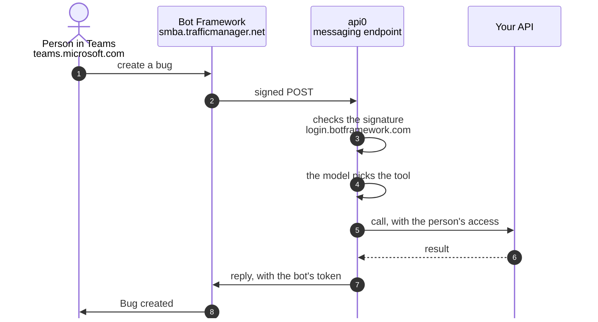

# Your API in Microsoft Teams, With Your Own Azure Bot

By the end of this guide, people message the bot in Teams, and the bot calls the api0 tenant's tools on their behalf, with their permissions. Teams only carries the conversation: the tools and the access are the ones you've already set up in api0, the same as in Claude.

Allow an hour, Microsoft's waits included.

Before you start:

- **An API that already works in api0**, for example Azure DevOps with [each person's Microsoft sign-in](/guides/azure-devops-microsoft-sign-in) (guide 05) or Azure services (guide 06). If each person signs in with their own account, they must have clicked **Connect** in api0.
- **Teams in your Microsoft directory**, with a licence for everyone who will talk to the bot (section 1).
- **Access to the Azure portal** with the right to create an *Azure Bot* resource.
- **A Teams Administrator** to approve the app (section 5).

## How a message travels

Teams reaches api0 through an **Azure Bot** of your own, in your directory. New bots are *single-tenant*: the people chatting with it must be in the same directory as the bot.



- **1–2.** Teams hands the message to the Bot Framework, which posts it, signed, to api0's messaging endpoint. If it breaks: section 4.
- **3.** api0 checks the message really comes from Microsoft. If it breaks: the Azure Bot, sections 2 and 3.
- **4.** The model picks the tool, for the linked person. If it breaks: link your Teams account, section 6.
- **5–6.** api0 calls your API with that person's access, as it does from Claude. If it breaks: your connection's guide (05 or 06).
- **7–8.** The reply goes back to Teams with the bot's token. If it breaks: the Azure Bot, section 2.

## 1. A Teams licence in your directory

Teams is a Microsoft 365 licence on the **directory**, not part of an Azure subscription. To check, sign in at `https://teams.microsoft.com` with a work account from your directory. *"You don't have the required permissions to access this org"* means no licence.

In a company that already has Teams, there's nothing to do. For a test directory without Teams, see the appendix.

## 2. The Azure Bot

In `https://portal.azure.com`, **Create → Azure Bot**:

| Field | Value |
|---|---|
| Bot handle | any name, e.g. `api0-bot` |
| Resource group | a new one, e.g. `api0` |
| Data residency | **Global** |
| Pricing tier | **Change plan → Free (F0)** |
| Type of App | **Single Tenant** |
| Creation type | **Create new Microsoft App ID** |

Then, in the bot → **Configuration**: copy the **Microsoft App ID** and the **App Tenant ID**. Click **Manage Password → New client secret** and copy its **Value**: it won't be shown again.

## 3. Connect the bot in api0

On [app.api0.ai → **Channels → Microsoft Teams**](https://app.api0.ai/?tab=channels&channel=teams), paste the App ID, the Microsoft tenant ID and the secret, and set a **Bot name**. That name is what everyone sees in Teams; left empty, it's the tenant name. Click **Connect**: api0 asks Microsoft for a token before saving, so a typo shows up here.

## 4. Point the bot at api0

1. In the **Microsoft Teams** block on api0's **Channels** page, the box **Finish in Azure and Teams** shows the **Messaging endpoint**. Copy it.
2. In Azure, bot → **Configuration → Messaging endpoint**: paste it, **Apply**.
3. Bot → **Channels → Microsoft Teams**: accept the terms, **Apply**. It should show as running.

The same api0 block also offers to link your Teams account right away. Wait until the app is installed (section 5): before that, the bot can't receive the code.

## 5. Install and approve the app

1. In the same **Finish in Azure and Teams** box, click **Download Teams app**. Keep the `.zip` as it is.
2. In Teams, **Apps → Manage your apps → Upload an app**. If your directory doesn't allow personal uploads, Teams submits the app to your organisation instead, and it shows as **Pending**.
3. A **Teams Administrator** approves it in `https://admin.teams.microsoft.com` → **Teams apps → Manage apps** → the app:
   - **Publish** the submitted version;
   - set **Status** to **Allowed** (a newly submitted app is **Blocked**);
   - **Actions → Org-wide app settings → Custom apps → Let users interact with custom apps**: on.

Approved changes can take up to an hour to reach Teams. The app then appears under **Apps → Built for your org**.

On a directory where Teams was just added, the admin center first shows *"We're setting up your new app management experience"*, and **Publish** stays grey for up to 30 minutes. Wait, then reload.

**If Publish stays grey for hours**, install the app for yourself instead: in the Teams admin center, **Teams apps → Setup policies → Global (Org-wide default) → Upload custom apps: On**, and keep custom apps allowed org-wide. About 15 minutes later, in Teams: **Apps** (the ⊞ icon in the left bar) → **Manage your apps → Upload an app → Upload a custom app**.

## 6. Link your Teams account and try it

Each person does this once:

1. In api0, **Channels → Microsoft Teams → Link your own Teams account**. A short code appears. It is single-use and expires after a few minutes; open the box again for a new one.
2. In Teams, click **Chat** and find the bot by its name. If it's not in the list, start a new chat and type its name.
3. Paste the code in the message box and send it. The bot answers: *"Linked. You are now `<api0 email>` here."*
4. Ask it something real, then check in your application that the action is recorded under your name. With Azure DevOps, for example:
   ```
   Create an issue "Login fails on Safari" in project <project> and assign it to firstname@your-company.com
   ```
   The work item shows up in `https://dev.azure.com/<organization>/<project>/_workitems/recent`, **Created By** your work account.

The bot only answers in one-to-one chats. Each person has their own conversation and history.

**Name people by their work email.** The bot knows you by your api0 email, which your application may not know, so it can't always work out "me".

Once the bot works for one API, it works for every API of the tenant: nothing changes in Teams when you add one.

## 7. Renaming the bot later

To change the name shown in Teams (or get api0's logo on an app downloaded before it had it):

1. api0 takes the **Bot name** only when connecting. On [**Channels → Microsoft Teams**](https://app.api0.ai/?tab=channels&channel=teams), click **Disconnect**, then fill in the form again: the same App ID and Microsoft tenant ID, the secret, and the new **Bot name**. Linked accounts and the Messaging endpoint stay as they were. If you didn't keep the secret's **Value**, create a new one first (bot → **Configuration → Manage Password → New client secret**).
2. Click **Download Teams app** again. Each download carries a higher version number, which Teams requires for an update.
3. In `https://admin.teams.microsoft.com` → **Teams apps → Manage apps**, open the app, click **Upload file** and choose the new `.zip`. Don't add it as a new app: it has the same ID.
4. **Publish** it if the admin center asks.

Teams takes the name and the icon from this app, not from the Azure Bot: its **Bot profile** in Azure can stay as it is. The new name can take up to an hour to reach Teams.

## Appendix: a Teams licence for a test directory

For a demo on a directory without Teams, use a **Microsoft Teams Essentials trial**, from inside your directory:

1. Give the account that will buy it the **Billing Administrator** role (Entra admin center → Users → the user → Assigned roles). The self-service sign-up page refuses an account your organisation manages, with *"ask your administrator"*: buy from the admin center instead.
2. **admin.microsoft.com → Billing → Purchase services → Microsoft Teams Essentials → Start free trial**.
3. Licences are assigned in the Microsoft 365 admin center only (Entra refuses). That needs the **License Administrator** role.
4. Set the user's **Usage location** first (Entra → Users → the user → Edit properties → Settings), or the assignment fails with *"invalid usage location"*.
5. **Billing → Licenses → Microsoft Teams Essentials → Assign licenses** → the user.
6. **Billing → Your products**: turn **Recurring billing** off if it's offered.

Wait about ten minutes, then check that `https://teams.microsoft.com` opens.

Give these admin roles to an administration account, never to the account that clicks **Connect** in api0: an admin account must use multi-factor sign-in, which a background renewal can't do (guide 05, step 5). In a test directory, remove these roles once Teams is in place.

## Error recap

| Message | Cause | Fix |
|---|---|---|
| Teams: `You don't have the required permissions to access this org` | No Teams licence in the directory | Section 1; for a test directory, the Teams Essentials trial in the appendix |
| Teams Essentials sign-up: "ask your administrator" | Self-service sign-up refuses managed accounts | Buy from admin.microsoft.com → Billing → Purchase services |
| `You don't have access to assign licenses` | Billing Administrator can buy, not assign | Add **License Administrator** |
| `License assignment cannot be done for user with invalid usage location` | The user has no country | Entra → the user → Edit properties → Settings → Usage location |
| Entra: licence changes "only available within the M365 Admin Center" | Entra no longer assigns licences | admin.microsoft.com → Billing → Licenses |
| api0 refuses the App ID or secret in section 3 | Secret pasted in the App ID field, expired secret, or wrong Microsoft tenant ID | The App ID is a GUID; create a new secret in the bot → Configuration → Manage Password |
| The bot doesn't answer | Messaging endpoint not pasted in Azure, or Teams channel not enabled | Section 4 |
| Teams app **Pending** after upload | Personal uploads not allowed, so the app was submitted to the organisation | Teams admin center → Manage apps → Publish |
| **Publish** greyed out, "setting up your new app management experience" | Teams admin center being prepared for the directory | Wait up to 30 minutes |
| Teams app **Blocked** | Default for a newly submitted app | Status → Allowed; allow custom apps org-wide |
| The bot doesn't recognise the linking code | The code expired or was already used | Open **Link your own Teams account** again for a new code |
