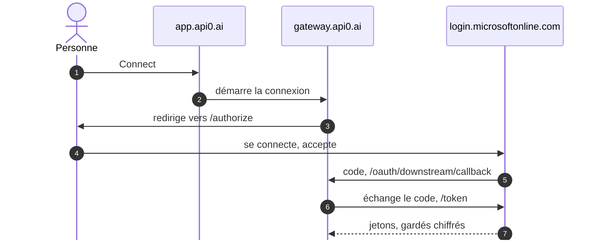

# Azure DevOps dans Claude, chacun avec son compte Microsoft

À la fin de ce guide, tu demandes dans Claude « crée un bug "La connexion échoue sous Safari" et assigne-le-moi », et le work item apparaît dans Azure DevOps **à ton nom**, avec **tes** droits. Personne ne colle de jeton : chacun clique une fois sur **Connect** et se connecte avec son compte Microsoft. api0 renouvelle ensuite l'accès tout seul.

Compte une heure, erreurs comprises. Pour la même chose dans Teams, enchaîne ensuite avec [le guide Teams](/fr/guides/ton-api-dans-teams) (guide 07).

Dans le guide, remplace :

| Repère | Ce que c'est | Où le trouver |
|---|---|---|
| `<tenant-id>` | L'identifiant de ton annuaire Microsoft (Entra ID) | Entra admin center → **Overview** → *Tenant ID* |
| `<organisation>` | Le nom de ton organisation Azure DevOps | `dev.azure.com/<organisation>` |
| `<projet>` | Un projet de cette organisation | `dev.azure.com/<organisation>/<projet>` |
| `<client-id>` | L'identifiant de l'application Entra créée à l'étape 2 | Page **Overview** de l'application |

## Comment ça marche

api0 ne détient jamais le mot de passe Microsoft de personne, seulement le jeton de chacun, émis par Entra ID et gardé chiffré. Une fois par personne, **Connect** :



- **1–3.** **Connect** envoie la personne vers `login.microsoftonline.com/<tenant-id>/oauth2/v2.0/authorize`. Si ça casse : étape 5.
- **4.** Elle se connecte avec son **compte professionnel** et accepte. Si ça casse : le consentement, étape 3.
- **5.** Entra ID renvoie un code à `gateway.api0.ai/oauth/downstream/callback`. Si ça casse : la Redirect URI, étape 2.
- **6–7.** La passerelle échange le code et garde les jetons chiffrés. Si ça casse : le secret de l'application, étape 2.

Ensuite, à chaque demande dans Claude, la passerelle renouvelle le jeton de la personne s'il a expiré, sans rien lui demander, et appelle `dev.azure.com/<organisation>` avec. Azure DevOps crée donc le work item à son nom et avec ses droits. Sans accès au projet, Azure DevOps refuse, et api0 n'ajoute aucun droit. Le chemin complet d'une requête et tous les domaines d'api0 sont dans le guide 04.

Deux sortes de comptes Microsoft entrent en jeu. Garde-les séparés :

| Compte | Rôle |
|---|---|
| **Administrateur de l'annuaire** | Crée l'application Entra et donne le consentement (étapes 2 et 3). **Ne l'utilise jamais pour Connect** : voir l'étape 5. |
| **Compte professionnel** | Celui que chacun utilise pour Connect et Azure DevOps. Un simple utilisateur : un accès **Basic** à Azure DevOps, et **aucun rôle d'administrateur**. |

## 1. Une organisation Azure DevOps sur le bon annuaire

L'organisation doit être rattachée **au même annuaire Entra** que celui où tu créeras l'application de l'étape 2. C'est cet annuaire qui délivrera les jetons.

Vérifie-le dans **Organization settings → Microsoft Entra** : l'annuaire affiché doit être `<tenant-id>`.

Pour créer une organisation sur cet annuaire :

1. Ouvre une **fenêtre privée** et va sur `https://aex.dev.azure.com/me`.
2. Connecte-toi avec un compte de cet annuaire.
3. Dans la liste déroulante des annuaires, choisis celui dont l'ID est `<tenant-id>`.
4. **Create new organization**, puis un projet. Choisis le processus **Agile** si tu veux un type **Bug** : le processus **Basic** n'a qu'Epic, Issue, Task et Test Case, et là tu demandes une **Issue**.

> **Erreur `TF400813: The user is not authorized to access this resource. The user is not a member of the AAD directory that the target Organization is connected to.`**
> Le navigateur était connecté avec un autre compte (personnel, ou d'un autre annuaire), et Azure DevOps a choisi le mauvais annuaire. La fenêtre privée et le choix explicite de l'annuaire sur `aex.dev.azure.com/me` règlent le problème.

## 2. Une application Entra dédiée à api0

Crée une application **rien que pour api0**. N'en réutilise pas une existante (celle d'une autre appli, ou une qui accepte les comptes Microsoft personnels) : les services Azure n'acceptent que les comptes professionnels, et tu veux pouvoir révoquer api0 sans rien casser d'autre.

Dans **Entra admin center → Identity → Applications → App registrations → New registration** :

- **Name** : `api0 downstream`
- **Supported account types** : *Accounts in any organizational directory (multitenant)*. Pas les comptes personnels. « Multitenant » permet plus tard à un client de consentir à la même application dans son propre annuaire.
- **Redirect URI** : plateforme **Web**, `https://gateway.api0.ai/oauth/downstream/callback`

Si les gens se connectent aussi **à api0** avec leur compte Microsoft, il faut une seconde Redirect URI : voir les variantes, plus bas.

Ensuite, dans l'application :

1. **Certificates & secrets** (menu de gauche, rubrique *Manage*) → onglet **Client secrets** → **New client secret**. Copie tout de suite la colonne **Value**, pas le *Secret ID* : elle ne sera plus affichée. Garde-la pour l'étape 4, ne l'envoie à personne. Si elle se retrouve un jour dans une conversation, un e-mail ou une capture d'écran, supprime-la et crée-en une nouvelle.
2. **API permissions → Add a permission** → **Azure DevOps** → **Delegated** → `user_impersonation`.

> **Tu ne trouves pas « Certificates & secrets » ?** Tu es sans doute dans **Certificate authorities**, un réglage de sécurité de tout l'annuaire. Le secret se crée *dans l'application* : ouvre **App registrations → All applications → api0 downstream**, et le menu apparaît à gauche.

## 3. Le consentement administrateur

Toujours dans **API permissions**, clique **Grant admin consent for \<ton annuaire\>**. Les permissions doivent passer au vert, *Granted*.

> **Erreur `Could not grant admin consent. Your organization does not have a subscription (or service principal) for the following API(s): …`**
> Un annuaire créé pour autre chose (des licences, par exemple) n'a pas forcément l'entrée locale (le *service principal*) des services Microsoft. Crée-les avec Azure CLI :
>
> ```bash
> az login --tenant <tenant-id> --allow-no-subscriptions
> ```
>
> ```bash
> az ad sp create --id 499b84ac-1321-427f-aa17-267ca6975798
> ```
>
> C'est Azure DevOps, le plus souvent celui qui manque. Si le message citait aussi Microsoft Graph (`00000003-0000-0000-c000-000000000000`) ou Azure Service Management (`797f4846-ba00-4fd7-ba43-dac1f8f63013`), lance la même commande avec leur ID. Une réponse *« The service principal name … is already in use »* veut dire qu'il **existe déjà** : rien à faire. Puis clique à nouveau sur **Grant admin consent**.

## 4. L'assistant api0

L'assistant remplace la **connexion par défaut** du tenant. Si ce tenant appelle déjà une autre API avec sa connexion par défaut, ajoute plutôt Azure DevOps comme **connexion nommée** (guide 06, section 3.1), avec les mêmes valeurs qu'à l'écran 4 ci-dessous.

L'adresse de ton compte api0 n'a **aucun lien** avec le compte Microsoft : au moment de **Connect**, c'est Microsoft qui te demande de te connecter, et tu choisis le compte de ton annuaire. Un compte api0 en Gmail qui se connecte à Azure DevOps avec `prenom@ton-entreprise.com` fonctionne très bien.

Sur [app.api0.ai](https://app.api0.ai), lance l'assistant de configuration (proposé à la première connexion, ou via le bouton **Reconfigure** de ton tenant) :

1. **Where do your people's work accounts live?** : *Microsoft 365 (Entra ID)*. Chacun se connecte alors à api0 en son nom, ce qui demande la seconde Redirect URI (voir les variantes).
2. **Import your API** : télécharge [les endpoints Azure DevOps](https://api0.ai/downloads/azure-devops-endpoints.json), remplace chaque `YOUR-ORGANIZATION` du fichier par `<organisation>`, puis importe-le. Il apparaît comme une API nommée **Azure DevOps**, sous **Custom API Groups** sur la page **API**, où tu peux la modifier comme n'importe quelle API. Ses outils arrivent dans Claude sous les noms `azure-devops-create-work-item`, `azure-devops-query-work-items`, etc. Importer plus tard un autre fichier la conserve, sauf s'il contient une API du même nom.
3. **Whose account should the API see?** : *Each person connects their own account*.
4. **Your application in Entra ID** :

| Champ | Valeur |
|---|---|
| Entra directory (tenant) ID | `<tenant-id>` |
| Application (client) ID | `<client-id>`, un GUID du type `c481c32b-…` |
| Client secret | la **Value** copiée à l'étape 2 |
| Scope | `499b84ac-1321-427f-aa17-267ca6975798/user_impersonation offline_access` |

Deux pièges :

- **Client ID et Client secret s'inversent facilement.** Le client ID est toujours un GUID (`xxxxxxxx-xxxx-…`). Un secret ressemble à `ofk8Q~…`. Un secret collé dans le champ Client ID donne `AADSTS700016` au moment de Connect.
- **Le scope n'est pas facultatif chez Microsoft.** Le texte grisé du champ est un exemple, pas une valeur. Un scope vide donne `AADSTS900144`. `499b84ac-…` désigne Azure DevOps.

5. Le dernier écran teste la connexion avec un appel en lecture seule. **Il doit échouer** avec un message du type « tu n'as pas encore ajouté ton accès » : normal, tu n'as pas encore connecté ton compte. La configuration est déjà enregistrée. Un bouton **Connect your account** se trouve juste sous le message : il fait la même chose que l'étape 5 ci-dessous.

**Reconfigurer plus tard.** Le bouton **Reconfigure** de ton tenant rouvre cet assistant avec les valeurs enregistrées. Les secrets ne sont jamais réaffichés : colle un nouveau secret, ou laisse le champ vide s'il indique qu'un secret est enregistré, et l'ancien est conservé.

## 5. Connect

Dans **Settings → My access tokens** (ou directement `app.api0.ai/?view=settings`), ton tenant apparaît avec **Not connected** et un bouton **Connect** :

1. Clique **Connect**.
2. Microsoft te demande de te connecter : choisis ton compte professionnel de l'annuaire `<tenant-id>`.
3. Tu reviens sur api0 avec **Your account is connected**.

Une fois connecté, le bouton devient **Reconnect** : il sert à se reconnecter, ou à passer à un autre compte professionnel.

Si Microsoft affiche une page d'erreur, reviens sur api0 en **rechargeant** la page, pas seulement avec le bouton Retour du navigateur : une page restaurée par Retour peut garder ses boutons grisés.

**Jamais avec un compte qui a un rôle d'administrateur.** Sur un annuaire avec les *Security defaults* (activés par défaut dans les nouveaux annuaires), les administrateurs doivent utiliser l'authentification multifacteur. api0 renouvelle les jetons en arrière-plan, où personne ne peut répondre à une demande multifacteur, donc Microsoft refuse le renouvellement. **Connect** refuse donc un compte qui détient un rôle d'annuaire autre que celui d'un utilisateur ordinaire, et l'explique sur **My access tokens**. Si un compte reçoit un rôle d'administrateur après s'être connecté, le renouvellement suivant échoue : le journal de connexion Entra (**Monitoring & health → Sign-in logs → User sign-ins (non-interactive)**) montre la tentative comme **Interrupted**, et le bot ou l'outil le signale. Correctif : retirer les rôles d'administrateur, puis **Reconnect**. Fais l'administration avec un compte séparé.

**Le compte doit avoir ouvert Azure DevOps une fois.** Azure DevOps refuse les appels d'API d'un compte qui ne s'est jamais connecté à son site. Le test répond alors HTTP 403, et le titre de la réponse indique *« Identity … has not been materialized, please use interactive login over the browser first »*. Ouvre une fois `https://dev.azure.com/<organisation>` dans un navigateur avec ce compte, puis relance le test.

**Toujours le même 403 après avoir ouvert Azure DevOps ?** Tu t'es sans doute connecté avec un compte Microsoft personnel invité dans l'annuaire. Dans **Entra admin center → Users**, son nom d'utilisateur principal ressemble à `prenom_domaine#EXT#@<annuaire>.onmicrosoft.com` (cherche l'ID cité dans l'erreur). Connect obtient un jeton pour cette identité de l'annuaire, alors que dev.azure.com te connecte avec le compte personnel lui-même : Azure DevOps ne rencontre donc jamais l'identité du jeton. Refais **Connect** avec un vrai compte professionnel de l'annuaire (**Use another account** dans le choix de compte Microsoft). Si l'annuaire n'en a pas encore, l'annexe montre comment en créer un.

## 6. Essayer, puis ouvrir aux autres

Ajoute le connecteur du tenant dans Claude, comme décrit dans le [guide principal](/fr/guides/ton-api-dans-claude), puis demande par exemple :

```
Crée une issue "La connexion échoue sous Safari" dans le projet <projet> et assigne-la à prenom@ton-entreprise.com
```

Ouvre `https://dev.azure.com/<organisation>/<projet>/_workitems/recent` : le work item y est, **Created By** ton compte professionnel.

**Nomme la personne assignée avec son e-mail professionnel.** api0 te connaît par ton e-mail api0, qu'Azure DevOps ne connaît pas, donc il ne peut pas deviner « moi ».

Si la réponse dit que le type n'existe pas, ton projet utilise le processus Basic : demande une **Issue** plutôt qu'un **Bug**.

Chaque nouvelle personne, sans droits d'administrateur :

1. Son administrateur l'ajoute à Azure DevOps (**Basic**, groupe **Contributors** du projet).
2. Elle ouvre une fois `https://dev.azure.com/<organisation>` dans un navigateur, pour qu'Azure DevOps la connaisse.
3. Elle se connecte à `app.api0.ai` (ou suit la page **Get started** du tenant), puis **Settings → My access tokens → Connect**, avec son compte professionnel.

Elle ne peut faire que ce que ses propres droits Azure DevOps permettent, et ce qu'elle crée lui est attribué, jamais à quelqu'un d'autre.

Pour Teams : [le guide Teams](/fr/guides/ton-api-dans-teams) (guide 07). Le bot utilise la même connexion, et chacun y lie son compte une fois.

## Variantes

**Les gens se connectent à api0 avec leur compte Microsoft.** C'est l'option *Microsoft 365 (Entra ID)* à l'écran 1 de l'assistant. La même application Entra s'en charge : dans **Authentication**, ajoute une seconde Redirect URI Web, `https://gateway.api0.ai/oauth/idp/callback`. Une application, deux Redirect URI, un seul secret.

**Les gens se connectent à api0 avec leur compte api0.** À l'écran 1, choisis *Neither*. À l'écran 3, choisis *Someone else's service*, puis *Other options* et *Each person connects their own account*. L'écran 4 demande alors aussi l'Authorization endpoint `https://login.microsoftonline.com/<tenant-id>/oauth2/v2.0/authorize` et le Token endpoint `https://login.microsoftonline.com/<tenant-id>/oauth2/v2.0/token`. Le scope doit toujours contenir `offline_access`.

**Des outils qui lisent aussi ton abonnement Azure** (ressources, coûts). Ajoute la permission déléguée **Azure Service Management** → `user_impersonation` à l'étape 2, et donne à ces outils leur propre connexion nommée, avec le scope `https://management.azure.com/user_impersonation offline_access` : un jeton Azure DevOps ne vaut pas pour Azure Resource Manager (guide 06, section 3).

## Annexe : un compte professionnel dans un annuaire de test

Un annuaire ouvert depuis un compte Microsoft personnel (fréquent pour un abonnement Azure créé pour autre chose) n'a souvent aucun compte professionnel natif. Pour en créer un :

1. **Entra admin center → Users → New user → Create new user**, par exemple `demo@<annuaire>.onmicrosoft.com`. Aucun rôle d'administrateur.
2. **Azure DevOps → Organization settings → Users → Add users** : ce compte, niveau d'accès **Basic**, projet `<projet>`, groupe **Project Contributors**.
3. Dans une fenêtre privée, ouvre `https://dev.azure.com/<organisation>/<projet>` avec ce compte et définis son mot de passe.
4. Dans api0, refais **Connect**. Dans le choix de compte Microsoft, prends **Use another account** et connecte-toi avec ce compte.

Garde le compte personnel pour l'administration (étapes 2 et 3), et ce compte-là pour Connect, Azure DevOps et Teams.

## Récapitulatif des erreurs

| Message | Cause | Correctif |
|---|---|---|
| `TF400813 … not a member of the AAD directory` | Mauvais compte ou mauvais annuaire dans le navigateur | Fenêtre privée, `aex.dev.azure.com/me`, choisir l'annuaire |
| Pas de « Certificates & secrets » | Tu es dans *Certificate authorities* | Ouvrir l'application elle-même dans *App registrations* |
| `Could not grant admin consent … no service principal` | L'annuaire n'a pas l'entrée locale d'un service Microsoft | `az ad sp create --id <ID du service>` puis consentir à nouveau |
| `… is already in use` en créant un service principal | Il existe déjà | Rien à faire |
| Le test de fin d'assistant échoue | Tu n'as pas encore cliqué sur Connect | **Connect your account**, ou Settings → My access tokens → Connect |
| `AADSTS700016: Application with identifier '…' was not found` | Le champ Client ID contient autre chose, souvent le secret | Client ID = le GUID de l'application ; nouveau secret si l'ancien a fuité |
| `AADSTS900144: The request body must contain the following parameter: 'scope'` | Scope vide | `499b84ac-1321-427f-aa17-267ca6975798/user_impersonation offline_access` |
| `AADSTS50011` (redirect URI mismatch) | L'application n'a pas la Redirect URI d'api0 | Ajouter `…/oauth/downstream/callback` (et `…/oauth/idp/callback` pour la connexion Microsoft) en **Web** |
| HTTP 403, `Identity … has not been materialized, please use interactive login over the browser first` | Le compte n'a jamais ouvert Azure DevOps dans un navigateur | Ouvrir une fois `dev.azure.com/<organisation>` avec ce compte, puis relancer le test |
| Le même 403, même après avoir ouvert Azure DevOps | Le jeton vise l'identité `#EXT#` d'un compte personnel dans l'annuaire | Refaire Connect avec un compte professionnel natif (annexe) |
| Boutons de l'assistant grisés au retour de Microsoft | Page restaurée par le bouton Retour | Recharger la page |
| Accès « pas configuré, ou expiré » le lendemain de Connect ; journal de la passerelle `invalid_grant` ; journal de connexion Entra **Interrupted** | Le compte connecté a reçu un rôle d'administrateur et doit passer par l'authentification multifacteur, impossible lors d'un renouvellement en arrière-plan | Retirer les rôles d'administrateur, puis **Reconnect** |
| `Work item type Bug does not exist in project` | Le projet utilise le processus Basic | Demander une **Issue**, ou utiliser un projet Agile |
