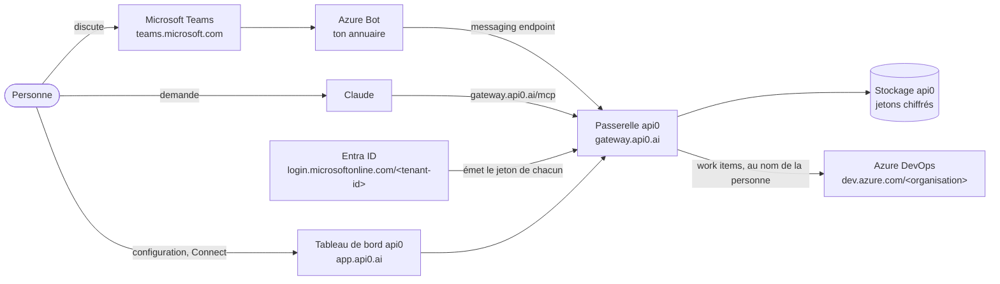

# Azure DevOps dans Claude et Teams, chacun avec son compte Microsoft

À la fin de ce guide, tu demandes dans Claude ou dans Teams « crée un bug "La connexion échoue sous Safari" et assigne-le-moi », et le work item apparaît dans Azure DevOps **à ton nom**, avec **tes** droits. Personne ne colle de jeton : chacun clique une fois sur **Connect** et se connecte avec son compte Microsoft. api0 renouvelle ensuite l'accès tout seul.

Compte une heure pour Azure DevOps et une autre pour Teams, erreurs comprises.

Dans le guide, remplace :

| Repère | Ce que c'est | Où le trouver |
|---|---|---|
| `<tenant-id>` | L'identifiant de ton annuaire Microsoft (Entra ID) | Entra admin center → **Overview** → *Tenant ID* |
| `<organisation>` | Le nom de ton organisation Azure DevOps | `dev.azure.com/<organisation>` |
| `<projet>` | Un projet de cette organisation | `dev.azure.com/<organisation>/<projet>` |
| `<client-id>` | L'identifiant de l'application Entra créée à l'étape 2 | Page **Overview** de l'application |

## Les systèmes en jeu

Cinq systèmes participent. api0 est au milieu : il ne détient jamais le mot de passe Microsoft de personne, seulement le jeton de chacun, émis par Entra ID.



Le même schéma en texte, pour les endroits qui n'affichent pas les diagrammes :

```
 Personne ── Teams ── Azure Bot ──┐
   │                              ├──> passerelle api0 ──> Azure DevOps
   └───── Claude ───── /mcp ──────┘       │      ▲      (au nom de la personne)
   │                                      ▼      │
   └── app.api0.ai (configuration, Connect)  stockage   Entra ID (émet les jetons)
```

### Les domaines

| Domaine | Système | Rôle |
|---|---|---|
| `app.api0.ai` | Tableau de bord api0 | Assistant de configuration, **Channels**, **Settings → My access tokens** (Connect). La page des réglages est `app.api0.ai/?view=settings`. |
| `gateway.api0.ai` | Passerelle api0 | Reçoit chaque appel, choisit le jeton de la personne, appelle Azure DevOps |
| `gateway.api0.ai/mcp` | Passerelle api0 | L'URL du connecteur à ajouter dans Claude |
| `gateway.api0.ai/oauth/downstream/callback` | Passerelle api0 | Où Microsoft renvoie les gens après **Connect**. Déclarée dans l'application Entra. |
| `gateway.api0.ai/oauth/idp/callback` | Passerelle api0 | Où Microsoft renvoie les gens après la connexion à api0, si tu as choisi la connexion Microsoft |
| Messaging endpoint Teams (affiché dans **Channels → Microsoft Teams**) | Passerelle api0 | Où l'Azure Bot livre les messages Teams |
| `api0.ai` | Site d'api0 | Politique de confidentialité et conditions vers lesquelles pointe l'application Teams |
| `login.microsoftonline.com/<tenant-id>` | Entra ID | Page de connexion et de consentement ; émet et renouvelle le jeton de chacun |
| `entra.microsoft.com` | Centre d'administration Entra | Application, consentement, utilisateurs, rôles, journaux de connexion |
| `portal.azure.com` | Portail Azure | L'Azure Bot |
| `admin.microsoft.com` | Centre d'administration Microsoft 365 | Licence Teams : essai, attribution, facturation |
| `admin.teams.microsoft.com` | Centre d'administration Teams | Approbation de l'application Teams, règles des applications personnalisées |
| `teams.microsoft.com` | Microsoft Teams | Là où l'on discute avec le bot |
| `dev.azure.com/<organisation>` | Azure DevOps | Là où vivent les work items |
| `aex.dev.azure.com` | Page de compte Azure DevOps | Création de l'organisation sur le bon annuaire |

### Les comptes

Il faut trois sortes de comptes. Garde-les séparés.

| Compte | Exemple | Rôle |
|---|---|---|
| **Compte api0** | `proprietaire@gmail.com` | Possède l'espace api0 et se connecte à `app.api0.ai`. N'importe quelle adresse : ce n'est pas ton identité Microsoft. |
| **Administrateur de l'annuaire** | `toi_domaine#EXT#@<annuaire>.onmicrosoft.com` (un compte Microsoft personnel ajouté à l'annuaire) | Crée l'application Entra, donne le consentement, crée les utilisateurs, attribue les licences. **Ne l'utilise jamais pour Connect** : voir l'étape 5. |
| **Compte professionnel** | `demo@<annuaire>.onmicrosoft.com` | Celui qu'on utilise pour Connect, Teams et Azure DevOps. Un simple utilisateur : une licence Teams, un accès **Basic** à Azure DevOps, et **aucun rôle d'administrateur**. |

### Ce que fait une nouvelle personne, sans droits d'administrateur

Un nouveau collègue avec un simple compte professionnel :

1. Son administrateur l'ajoute à Azure DevOps (**Basic**, groupe **Contributors** du projet) et lui donne une licence Teams.
2. Il ouvre une fois `https://dev.azure.com/<organisation>` dans un navigateur, pour qu'Azure DevOps le connaisse.
3. Il se connecte à `app.api0.ai` (ou suit la page **Get started** de l'espace), puis **Settings → My access tokens → Connect**, avec son compte professionnel.
4. Dans Teams, il ouvre le bot, lie son compte avec le code d'api0 (étape 6.6), et pose sa question.

Il ne peut faire que ce que ses propres droits Azure DevOps permettent. Ce qu'il crée lui est attribué, jamais à quelqu'un d'autre. Sans accès au projet, Azure DevOps refuse, et api0 n'ajoute aucun droit.

## 1. Une organisation Azure DevOps sur le bon annuaire

L'organisation doit être rattachée **au même annuaire Entra** que celui où tu créeras l'application de l'étape 2. C'est cet annuaire qui délivrera les jetons.

1. Ouvre une **fenêtre privée** et va sur `https://aex.dev.azure.com/me`.
2. Connecte-toi avec un compte de cet annuaire (celui qui l'administre, idéalement).
3. Dans la liste déroulante des annuaires, choisis celui dont l'ID est `<tenant-id>`.
4. **Create new organization**, puis un projet. Choisis le processus **Agile** si tu veux un type **Bug** : le processus **Basic** n'a qu'Epic, Issue, Task et Test Case, et là tu demandes une **Issue**.
5. Vérifie dans **Organization settings → Microsoft Entra** que l'annuaire affiché est bien le tien.

> **Erreur `TF400813: The user is not authorized to access this resource. The user is not a member of the AAD directory that the target Organization is connected to.`**
> Le navigateur était connecté avec un autre compte (personnel, ou d'un autre annuaire), et Azure DevOps a choisi le mauvais annuaire. La fenêtre privée et le choix explicite de l'annuaire sur `aex.dev.azure.com/me` règlent le problème.

## 2. Une application Entra dédiée à api0

Crée une application **rien que pour api0**. N'en réutilise pas une existante (celle d'une autre appli, ou une qui accepte les comptes Microsoft personnels) : les services Azure n'acceptent que les comptes professionnels, et tu veux pouvoir révoquer api0 sans rien casser d'autre.

Dans **Entra admin center → Identity → Applications → App registrations → New registration** :

- **Name** : `api0 downstream`
- **Supported account types** : *Accounts in any organizational directory (multitenant)*. Pas les comptes personnels. « Multitenant » permet plus tard à un client de consentir à la même application dans son propre annuaire.
- **Redirect URI** : plateforme **Web**, `https://gateway.api0.ai/oauth/downstream/callback`

Si les gens se connectent aussi **à api0** avec leur compte Microsoft (option *Microsoft work accounts* à l'étape 4), la même application s'en charge : dans **Authentication**, ajoute une seconde Redirect URI Web, `https://gateway.api0.ai/oauth/idp/callback`. Une application, deux Redirect URI, un seul secret.

Ensuite, dans l'application :

1. **Certificates & secrets** (menu de gauche, rubrique *Manage*) → onglet **Client secrets** → **New client secret**. Copie tout de suite la colonne **Value**, pas le *Secret ID* : elle ne sera plus affichée. Garde-la pour l'étape 4, ne l'envoie à personne. Si elle se retrouve un jour dans une conversation, un e-mail ou une capture d'écran, supprime-la et crée-en une nouvelle.
2. **API permissions → Add a permission**, en **Delegated** :
   - **Azure DevOps** → `user_impersonation`
   - **Azure Service Management** → `user_impersonation`, seulement si tu veux aussi des outils qui lisent ton abonnement Azure (ressources, coûts).

> **Tu ne trouves pas « Certificates & secrets » ?** Tu es sans doute dans **Certificate authorities**, un réglage de sécurité de tout l'annuaire. Le secret se crée *dans l'application* : ouvre **App registrations → All applications → api0 downstream**, et le menu apparaît à gauche.

## 3. Le consentement administrateur

Toujours dans **API permissions**, clique **Grant admin consent for \<ton annuaire\>**. Les permissions doivent passer au vert, *Granted*.

> **Erreur `Could not grant admin consent. Your organization does not have a subscription (or service principal) for the following API(s): …`**
> Un annuaire créé pour autre chose (des licences, par exemple) n'a pas forcément l'entrée locale (le *service principal*) des services Microsoft. Crée-les avec Azure CLI :
>
> ```bash
> az login --tenant <tenant-id> --allow-no-subscriptions
> ```
>
> ```bash
> az ad sp create --id 499b84ac-1321-427f-aa17-267ca6975798
> ```
>
> C'est Azure DevOps, le plus souvent celui qui manque. Si le message citait aussi Microsoft Graph (`00000003-0000-0000-c000-000000000000`) ou Azure Service Management (`797f4846-ba00-4fd7-ba43-dac1f8f63013`), lance la même commande avec leur ID. Une réponse *« The service principal name … is already in use »* veut dire qu'il **existe déjà** : rien à faire. Puis clique à nouveau sur **Grant admin consent**.

## 4. L'assistant api0

### Quel compte api0 ?

Aujourd'hui, un compte api0 possède **un seul espace de travail**, et l'assistant remplace la connexion par défaut de cet espace. Si ton compte sert déjà à une autre intégration, crée un deuxième compte api0 (une autre adresse e-mail) pour celle-ci.

L'adresse de ton compte api0 n'a **aucun lien** avec le compte Microsoft : au moment de **Connect**, c'est Microsoft qui te demande de te connecter, et tu choisis le compte de ton annuaire. Un compte api0 en Gmail qui se connecte à Azure DevOps avec `prenom@ton-entreprise.com` fonctionne très bien.

> Bientôt : les **connexions nommées** permettront plusieurs connexions dans un même espace, par exemple Azure DevOps par défaut et une connexion `arm` pour Azure Resource Manager, sans deuxième compte.

### Les écrans

Sur [app.api0.ai](https://app.api0.ai), lance l'assistant de configuration (proposé à la première connexion, ou via le bouton **Reconfigure** de ton espace) :

1. **What should this workspace connect to?** : *Azure DevOps*.
2. **How do your people sign in?** : ce choix ne concerne que la connexion à api0 (depuis Claude ou Teams). La connexion à Azure DevOps vient plus tard, avec **Connect**. Les deux options conviennent :
   - *An api0 account* : rien de plus à remplir.
   - *Microsoft work accounts (Entra ID)* : chacun se connecte à api0 en son nom. Renseigne le **Directory (tenant) ID** `<tenant-id>`, l'**Application (client) ID** `<client-id>` et le secret de l'étape 2. Il faut alors la seconde Redirect URI de l'étape 2.
3. **Whose account should the service see?** : *Each person connects their own account*. Pas l'option « Recommended », qui fait coller un jeton à chacun.
4. **Where is your Azure DevOps?** :

| Champ | Valeur |
|---|---|
| Organisation | `<organisation>` |
| Test project | `<projet>` |
| Authorization endpoint | `https://login.microsoftonline.com/<tenant-id>/oauth2/v2.0/authorize` |
| Token endpoint | `https://login.microsoftonline.com/<tenant-id>/oauth2/v2.0/token` |
| Client ID | `<client-id>`, un GUID du type `c481c32b-…` |
| Client secret | la **Value** copiée à l'étape 2 |
| Scope | `499b84ac-1321-427f-aa17-267ca6975798/user_impersonation offline_access` |

Si tu as choisi la connexion Microsoft à l'écran 2, l'assistant a peut-être déjà rempli les endpoints, le client ID et le scope. Vérifie-les plutôt que de les retaper.

Trois pièges :

- **Client ID et Client secret s'inversent facilement.** Le client ID est toujours un GUID (`xxxxxxxx-xxxx-…`). Un secret ressemble à `ofk8Q~…`. Un secret collé dans le champ Client ID donne `AADSTS700016` au moment de Connect.
- **Le scope n'est pas facultatif chez Microsoft.** Le texte grisé du champ (`api://resource/.default`) est un exemple, pas une valeur. Un scope vide donne `AADSTS900144`.
- **`offline_access` est indispensable.** `499b84ac-…` désigne Azure DevOps. Sans `offline_access`, Microsoft ne renvoie pas de jeton de rafraîchissement, et api0 refuse la connexion plutôt que de la laisser expirer au bout d'une heure.

**Ce que l'assistant ajoute.** Il importe dans l'espace une API nommée **Azure DevOps**, comme tu importerais ton propre fichier : 12 opérations sur les work items (créer, lire, rechercher, commenter), les projets, les équipes, les sprints et les zones. Elle apparaît sur la page **API**, sous **Custom API Groups**, où tu peux la modifier comme n'importe quelle API. Ses outils arrivent dans Claude sous les noms `azure-devops-create-work-item`, `azure-devops-query-work-items`, etc. Importer plus tard ton propre fichier la conserve, sauf si ton fichier contient une API du même nom.

**Reconfigurer plus tard.** Le bouton **Reconfigure** de ton espace rouvre cet assistant avec les valeurs enregistrées. Les secrets ne sont jamais réaffichés : colle un nouveau secret, ou laisse le champ vide s'il indique qu'un secret est enregistré, et l'ancien est conservé.

5. Le dernier écran teste la connexion. **Il doit échouer** avec un message du type « tu n'as pas encore ajouté ton accès » : normal, tu n'as pas encore connecté ton compte. La configuration est déjà enregistrée. Un bouton **Connect your account** se trouve juste sous le message : il fait la même chose que l'étape 5 ci-dessous.

## 5. Connect

Dans **Settings → My access tokens**, ton espace apparaît avec **Not connected** et un bouton **Connect** :

1. Clique **Connect**.
2. Microsoft te demande de te connecter : choisis ton compte de l'annuaire `<tenant-id>`.
3. Tu reviens sur api0 avec **Your account is connected**.

Une fois connecté, le bouton devient **Reconnect** : il sert à se reconnecter, ou à passer à un autre compte professionnel. La page des réglages s'ouvre aussi directement sur `app.api0.ai/?view=settings`.

**Ne te connecte jamais avec un compte qui a un rôle d'administrateur.** Sur un annuaire avec les *Security defaults* (activés par défaut dans les nouveaux annuaires), les administrateurs doivent utiliser l'authentification multifacteur. api0 renouvelle les jetons en arrière-plan, où personne ne peut répondre à une demande multifacteur, donc Microsoft refuse le renouvellement. Dans notre test, le compte professionnel a reçu Billing, License et Teams Administrator après s'être connecté. Le lendemain matin :
- le journal de connexion Entra (**Monitoring & health → Sign-in logs → User sign-ins (non-interactive)**) montrait la tentative de l'application comme **Interrupted** ;
- la passerelle d'api0 enregistrait `invalid_grant` ;
- le bot répondait que l'accès n'était pas configuré.

Correctif : retirer les rôles d'administrateur, puis **Reconnect**. Fais l'administration avec un compte séparé.

api0 l'impose désormais. **Connect** refuse un compte qui détient un rôle d'annuaire autre que celui d'un utilisateur ordinaire, et l'explique sur **My access tokens**. Si un compte devient administrateur après s'être connecté, le bot le dit au renouvellement suivant au lieu de « accès non configuré ». Même chose quand Microsoft exige une connexion multifacteur.

**Le compte doit avoir ouvert Azure DevOps une fois.** Azure DevOps refuse les appels d'API d'un compte qui ne s'est jamais connecté à son site. Le test répond alors HTTP 403, et le titre de la réponse indique *« Identity … has not been materialized, please use interactive login over the browser first »*. Ouvre une fois `https://dev.azure.com/<organisation>` dans un navigateur avec ce compte, puis relance le test. Chaque nouvelle personne de l'espace doit aussi le faire une fois.

**Toujours le même 403 après avoir ouvert Azure DevOps ? Vérifie s'il s'agit d'un compte personnel.** Si ton annuaire a été créé depuis un compte Microsoft personnel (fréquent pour un abonnement ouvert pour autre chose), ce compte figure dans l'annuaire comme *membre externe*. Dans **Entra admin center → Users**, son nom d'utilisateur principal ressemble à `prenom_domaine#EXT#@<annuaire>.onmicrosoft.com`. Connect obtient un jeton pour cette identité de l'annuaire, alors que dev.azure.com te connecte avec le compte personnel lui-même : Azure DevOps ne rencontre donc jamais l'identité du jeton. Pour le vérifier, cherche l'ID cité dans l'erreur sous **Users**. La solution est un compte professionnel natif :

1. **Entra admin center → Users → New user → Create new user**, par exemple `demo@<annuaire>.onmicrosoft.com`.
2. **Azure DevOps → Organization settings → Users → Add users** : ce compte, niveau d'accès **Basic**, projet `<projet>`, groupe **Project Contributors**.
3. Dans une fenêtre privée, ouvre `https://dev.azure.com/<organisation>/<projet>` avec ce compte et définis son mot de passe.
4. Dans api0, refais **Connect**. Dans le choix de compte Microsoft, prends **Use another account** et connecte-toi avec le compte professionnel.

Dans une vraie entreprise, chacun a déjà un compte professionnel, et la question ne se pose pas.

Si Microsoft affiche une page d'erreur, reviens sur api0 en **rechargeant** la page, pas seulement avec le bouton Retour du navigateur : une page restaurée par Retour peut garder ses boutons grisés.

Chaque personne de l'espace fait la même chose une fois. Elle n'agit qu'avec ses propres droits Azure DevOps, et rien n'est jamais attribué à quelqu'un d'autre.

## 6. Dans Teams

Teams passe par un **Azure Bot** à toi, dans ton annuaire. Les nouveaux bots sont *single-tenant* : les personnes qui lui parlent doivent être dans le même annuaire que le bot. Chacun connecte toujours son propre compte Azure DevOps (étape 5) ; Teams ne fait que porter la conversation.

### 6.1 Une licence Teams dans ton annuaire

Teams est une licence Microsoft 365 rattachée à l'**annuaire**, pas à un abonnement Azure. Pour vérifier, connecte-toi sur `https://teams.microsoft.com` avec un compte professionnel de `<tenant-id>`. *« You don't have the required permissions to access this org »* signifie : pas de licence.

Pour une démo, prends un **essai Microsoft Teams Essentials**, depuis ton annuaire :

1. Donne au compte qui achète le rôle **Billing Administrator** (Entra admin center → Users → l'utilisateur → Assigned roles). La page d'inscription en libre-service refuse un compte géré par ton organisation (*« demandez à votre administrateur »*) : achète plutôt depuis le centre d'administration.
2. **admin.microsoft.com → Facturation → Acheter des services → Microsoft Teams Essentials → essai gratuit**.
3. Les licences ne s'attribuent plus que dans le centre d'administration Microsoft 365 (Entra refuse). Il faut pour cela le rôle **License Administrator**.
4. Renseigne d'abord l'**emplacement d'utilisation** de l'utilisateur (Entra → Users → l'utilisateur → Edit properties → Settings → Usage location), sinon l'attribution échoue avec *« invalid usage location »*.
5. **Facturation → Licences → Microsoft Teams Essentials → Attribuer des licences** → l'utilisateur.
6. **Facturation → Vos produits** : désactive la **facturation récurrente** si l'option est proposée.

Attends une dizaine de minutes, puis vérifie que `https://teams.microsoft.com` s'ouvre.

Dans une entreprise qui a déjà Teams, saute tout ce point.

### 6.2 L'Azure Bot

Dans `https://portal.azure.com`, **Create → Azure Bot** :

| Champ | Valeur |
|---|---|
| Bot handle | un nom au choix, par exemple `api0-demo-bot` |
| Resource group | un nouveau, par exemple `api0-demo` |
| Data residency | **Global** |
| Pricing tier | **Change plan → Free (F0)** |
| Type of App | **Single Tenant** |
| Creation type | **Create new Microsoft App ID** |

Puis, dans le bot → **Configuration** : copie le **Microsoft App ID** et l'**App Tenant ID**. Clique **Manage Password → New client secret** et copie sa **Value**.

### 6.3 Brancher le bot dans api0

Sur [app.api0.ai → **Channels → Microsoft Teams**](https://app.api0.ai/?tab=channels&channel=teams), colle l'App ID, le tenant ID et le secret, et donne un **Bot name**. C'est le nom que tout le monde verra dans Teams ; laissé vide, c'est le nom de l'espace. Clique **Connect** : api0 demande un jeton à Microsoft avant d'enregistrer, donc une faute de frappe se voit ici.

### 6.4 Faire pointer le bot vers api0

1. Dans le bloc **Microsoft Teams** de la page **Channels** d'api0, l'encadré **Finish in Azure and Teams** affiche le **Messaging endpoint**. Copie-le.
2. Dans Azure, bot → **Configuration → Messaging endpoint** : colle-le, **Apply**.
3. Bot → **Channels → Microsoft Teams** : accepte les conditions, **Apply**. Le canal doit apparaître comme actif.

Le même bloc d'api0 propose aussi de lier tout de suite ton compte Teams. Attends que l'application soit installée (6.5) : avant, le bot ne peut pas recevoir le code.

### 6.5 Installer et approuver l'application

1. Dans le même encadré **Finish in Azure and Teams**, clique **Download Teams app**. Garde le `.zip` tel quel.
2. Dans Teams, **Apps → Manage your apps → Upload an app**. Si ton annuaire n'autorise pas l'envoi personnel, Teams soumet l'application à ton organisation, et elle apparaît **Pending**.
3. Un **Teams Administrator** l'approuve dans `https://admin.teams.microsoft.com` → **Teams apps → Manage apps** → l'application :
   - **Publish** la version soumise ;
   - passe **Status** à **Allowed** (une application tout juste soumise est **Blocked**) ;
   - **Actions → Org-wide app settings → Custom apps → Let users interact with custom apps** : activé.

Sur un annuaire où Teams vient d'arriver, le centre d'administration affiche d'abord *« We're setting up your new app management experience »*, et **Publish** reste grisé jusqu'à 30 minutes. Attends, puis recharge.

Les changements approuvés peuvent mettre jusqu'à une heure à arriver dans Teams. L'application apparaît ensuite sous **Apps → Built for your org**.

**Si Publish reste grisé pendant des heures**, installe l'application pour toi seul : dans le centre d'administration Teams, **Teams apps → Setup policies → Global (Org-wide default) → Upload custom apps : On**, et garde les applications personnalisées autorisées pour l'organisation. Une quinzaine de minutes plus tard, dans Teams : **Apps** (l'icône ⊞ de la barre de gauche) → **Manage your apps → Upload an app → Upload a custom app**.

**Renommer plus tard** (ou donner le logo d'api0 à une application téléchargée avant qu'il y soit) :

1. api0 ne prend le **Bot name** qu'au branchement. Sur [**Channels → Microsoft Teams**](https://app.api0.ai/?tab=channels&channel=teams), clique **Disconnect**, puis remplis à nouveau le formulaire : le même App ID et le même tenant ID, le secret, et le nouveau **Bot name**, par exemple `api0`. Les comptes liés et le Messaging endpoint restent tels quels. Si tu n'as pas gardé la **Value** du secret, crées-en d'abord un nouveau (bot → **Configuration → Manage Password → New client secret**).
2. Clique à nouveau **Download Teams app**. Chaque téléchargement porte un numéro de version plus élevé, ce que Teams exige pour une mise à jour.
3. Dans `https://admin.teams.microsoft.com` → **Teams apps → Manage apps**, ouvre l'application, clique **Upload file** et choisis le nouveau `.zip`. Ne l'ajoute pas comme nouvelle application : elle a le même ID.
4. Si le centre d'administration le demande, clique **Publish**.

Teams prend le nom et l'icône dans cette application, pas dans l'Azure Bot : son **Bot profile** dans Azure peut rester tel quel. Le nouveau nom peut mettre jusqu'à une heure à arriver dans Teams.

### 6.6 Lier son compte Teams et essayer

1. Dans api0, **Channels → Microsoft Teams → Link your own Teams account**. Un code court apparaît. Il ne sert qu'une fois et expire au bout de quelques minutes ; rouvre l'encadré pour en avoir un nouveau.
2. Dans Teams, clique **Chat** et cherche le bot par son nom. S'il n'est pas dans la liste, démarre une nouvelle conversation et tape son nom.
3. Colle le code dans la zone de message et envoie-le. Le bot répond : *« Linked. You are now `<e-mail api0>` here. »*
4. Demande-lui quelque chose de réel, par exemple :
   ```
   Create an issue "Login fails on Safari" in project <projet> and assign it to prenom@<annuaire>.onmicrosoft.com
   ```
5. Ouvre `https://dev.azure.com/<organisation>/<projet>/_workitems/recent` : le work item y est, **Created By** ton compte professionnel.

**Nomme la personne assignée avec son e-mail professionnel.** Le bot te connaît par ton e-mail api0, qu'Azure DevOps ne connaît pas, donc il ne peut pas deviner « moi ».

Si le bot dit que le type n'existe pas, ton projet utilise le processus Basic : demande une **Issue** plutôt qu'un **Bug**.

**Les rôles dans un annuaire de test.** Ci-dessus, le compte de test a reçu Billing Administrator, License Administrator et Teams Administrator pour tout faire. Dans une vraie entreprise, un administrateur existant fait ces étapes. Dans un annuaire de test, retire ces rôles ensuite.

## Récapitulatif des erreurs

| Message | Cause | Correctif |
|---|---|---|
| `TF400813 … not a member of the AAD directory` | Mauvais compte ou mauvais annuaire dans le navigateur | Fenêtre privée, `aex.dev.azure.com/me`, choisir l'annuaire |
| Pas de « Certificates & secrets » | Tu es dans *Certificate authorities* | Ouvrir l'application elle-même dans *App registrations* |
| `Could not grant admin consent … no service principal` | L'annuaire n'a pas l'entrée locale d'un service Microsoft | `az ad sp create --id <ID du service>` puis consentir à nouveau |
| `… is already in use` en créant un service principal | Il existe déjà | Rien à faire |
| Le test de fin d'assistant échoue | Tu n'as pas encore cliqué sur Connect | **Connect your account**, ou Settings → My access tokens → Connect |
| `AADSTS700016: Application with identifier '…' was not found` | Le champ Client ID contient autre chose, souvent le secret | Client ID = le GUID de l'application ; nouveau secret si l'ancien a fuité |
| `AADSTS900144: The request body must contain the following parameter: 'scope'` | Scope vide | `499b84ac-1321-427f-aa17-267ca6975798/user_impersonation offline_access` |
| `AADSTS50011` (redirect URI mismatch) | L'application n'a pas la Redirect URI d'api0 | Ajouter `…/oauth/downstream/callback` (et `…/oauth/idp/callback` pour la connexion Microsoft) en **Web** |
| HTTP 403, `Identity … has not been materialized, please use interactive login over the browser first` | Le compte n'a jamais ouvert Azure DevOps dans un navigateur | Ouvrir une fois `dev.azure.com/<organisation>` avec ce compte, puis relancer le test |
| Le même 403, même après avoir ouvert Azure DevOps | Le jeton vise l'identité `#EXT#` d'un compte personnel dans l'annuaire | Créer un compte professionnel natif, l'ajouter à l'organisation, refaire Connect avec lui |
| Teams : `You don't have the required permissions to access this org` | Pas de licence Teams dans l'annuaire | 6.1 : essai Teams Essentials |
| Inscription Teams Essentials : « demandez à votre administrateur » | L'inscription en libre-service refuse les comptes gérés | Acheter depuis admin.microsoft.com → Facturation → Acheter des services |
| `You don't have access to assign licenses` | Billing Administrator peut acheter, pas attribuer | Ajouter **License Administrator** |
| `License assignment cannot be done for user with invalid usage location` | L'utilisateur n'a pas de pays | Entra → l'utilisateur → Edit properties → Settings → Usage location |
| Entra : licences « only available within the M365 Admin Center » | Entra n'attribue plus les licences | admin.microsoft.com → Facturation → Licences |
| Application Teams **Pending** après l'envoi | Envoi personnel interdit, l'application a été soumise à l'organisation | Centre d'administration Teams → Manage apps → Publish |
| **Publish** grisé, « setting up your new app management experience » | Le centre d'administration Teams se prépare pour l'annuaire | Attendre jusqu'à 30 minutes |
| Application Teams **Blocked** | Valeur par défaut d'une application soumise | Status → Allowed ; autoriser les applications personnalisées pour l'organisation |
| Boutons de l'assistant grisés au retour de Microsoft | Page restaurée par le bouton Retour | Recharger la page |
| Bot : accès « pas configuré, ou expiré » le lendemain de Connect ; journal de la passerelle `invalid_grant` ; journal de connexion Entra **Interrupted** | Le compte connecté a un rôle d'administrateur et doit passer par l'authentification multifacteur, impossible lors d'un renouvellement en arrière-plan | Retirer les rôles d'administrateur, puis **Reconnect** |
| `Work item type Bug does not exist in project` | Le projet utilise le processus Basic | Demander une **Issue**, ou utiliser un projet Agile |
