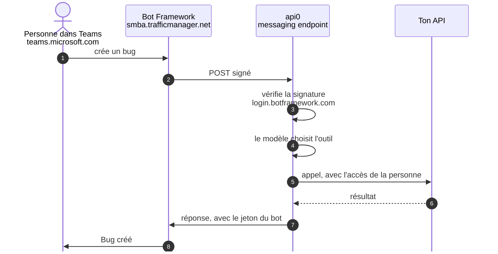

# Ton API dans Microsoft Teams, avec ton propre Azure Bot

À la fin de ce guide, chacun écrit au bot dans Teams, et le bot appelle les outils du tenant api0 en son nom, avec ses droits. Teams ne fait que porter la conversation : les outils et les accès sont ceux que tu as déjà configurés dans api0, les mêmes que dans Claude.

Compte une heure, attentes de Microsoft comprises.

Avant de commencer :

- **Une API qui marche déjà dans api0**, par exemple Azure DevOps avec la [connexion Microsoft de chacun](/fr/guides/azure-devops-connexion-microsoft) (guide 05) ou des services Azure (guide 06). Si chacun se connecte avec son propre compte, il doit avoir cliqué sur **Connect** dans api0.
- **Teams dans ton annuaire Microsoft**, avec une licence pour chaque personne qui parlera au bot (section 1).
- **Un accès au portail Azure** avec le droit de créer une ressource *Azure Bot*.
- **Un Teams Administrator** pour approuver l'application (section 5).

## Comment un message circule

Teams passe par un **Azure Bot** à toi, dans ton annuaire. Les nouveaux bots sont *single-tenant* : les personnes qui lui parlent doivent être dans le même annuaire que le bot.



- **1–2.** Teams passe le message au Bot Framework, qui le poste, signé, sur le messaging endpoint d'api0. Si ça casse : section 4.
- **3.** api0 vérifie que le message vient bien de Microsoft. Si ça casse : l'Azure Bot, sections 2 et 3.
- **4.** Le modèle choisit l'outil, pour la personne liée. Si ça casse : lier son compte Teams, section 6.
- **5–6.** api0 appelle ton API avec l'accès de cette personne, comme depuis Claude. Si ça casse : le guide de ta connexion (05 ou 06).
- **7–8.** La réponse repart vers Teams avec le jeton du bot. Si ça casse : l'Azure Bot, section 2.

## 1. Une licence Teams dans ton annuaire

Teams est une licence Microsoft 365 rattachée à l'**annuaire**, pas à un abonnement Azure. Pour vérifier, connecte-toi sur `https://teams.microsoft.com` avec un compte professionnel de ton annuaire. *« You don't have the required permissions to access this org »* signifie : pas de licence.

Dans une entreprise qui a déjà Teams, il n'y a rien à faire. Pour un annuaire de test sans Teams, voir l'annexe.

## 2. L'Azure Bot

Dans `https://portal.azure.com`, **Create → Azure Bot** :

| Champ | Valeur |
|---|---|
| Bot handle | un nom au choix, par exemple `api0-bot` |
| Resource group | un nouveau, par exemple `api0` |
| Data residency | **Global** |
| Pricing tier | **Change plan → Free (F0)** |
| Type of App | **Single Tenant** |
| Creation type | **Create new Microsoft App ID** |

Puis, dans le bot → **Configuration** : copie le **Microsoft App ID** et l'**App Tenant ID**. Clique **Manage Password → New client secret** et copie sa **Value** : elle ne sera plus affichée.

## 3. Brancher le bot dans api0

Sur [app.api0.ai → **Channels → Microsoft Teams**](https://app.api0.ai/?tab=channels&channel=teams), colle l'App ID, le tenant ID Microsoft et le secret, et donne un **Bot name**. C'est le nom que tout le monde verra dans Teams ; laissé vide, c'est le nom du tenant. Clique **Connect** : api0 demande un jeton à Microsoft avant d'enregistrer, donc une faute de frappe se voit ici.

## 4. Faire pointer le bot vers api0

1. Dans le bloc **Microsoft Teams** de la page **Channels** d'api0, l'encadré **Finish in Azure and Teams** affiche le **Messaging endpoint**. Copie-le.
2. Dans Azure, bot → **Configuration → Messaging endpoint** : colle-le, **Apply**.
3. Bot → **Channels → Microsoft Teams** : accepte les conditions, **Apply**. Le canal doit apparaître comme actif.

Le même bloc d'api0 propose aussi de lier tout de suite ton compte Teams. Attends que l'application soit installée (section 5) : avant, le bot ne peut pas recevoir le code.

## 5. Installer et approuver l'application

1. Dans le même encadré **Finish in Azure and Teams**, clique **Download Teams app**. Garde le `.zip` tel quel.
2. Dans Teams, **Apps → Manage your apps → Upload an app**. Si ton annuaire n'autorise pas l'envoi personnel, Teams soumet l'application à ton organisation, et elle apparaît **Pending**.
3. Un **Teams Administrator** l'approuve dans `https://admin.teams.microsoft.com` → **Teams apps → Manage apps** → l'application :
   - **Publish** la version soumise ;
   - passe **Status** à **Allowed** (une application tout juste soumise est **Blocked**) ;
   - **Actions → Org-wide app settings → Custom apps → Let users interact with custom apps** : activé.

Les changements approuvés peuvent mettre jusqu'à une heure à arriver dans Teams. L'application apparaît ensuite sous **Apps → Built for your org**.

Sur un annuaire où Teams vient d'arriver, le centre d'administration affiche d'abord *« We're setting up your new app management experience »*, et **Publish** reste grisé jusqu'à 30 minutes. Attends, puis recharge.

**Si Publish reste grisé pendant des heures**, installe l'application pour toi seul : dans le centre d'administration Teams, **Teams apps → Setup policies → Global (Org-wide default) → Upload custom apps : On**, et garde les applications personnalisées autorisées pour l'organisation. Une quinzaine de minutes plus tard, dans Teams : **Apps** (l'icône ⊞ de la barre de gauche) → **Manage your apps → Upload an app → Upload a custom app**.

## 6. Lier son compte Teams et essayer

Chaque personne le fait une fois :

1. Dans api0, **Channels → Microsoft Teams → Link your own Teams account**. Un code court apparaît. Il ne sert qu'une fois et expire au bout de quelques minutes ; rouvre l'encadré pour en avoir un nouveau.
2. Dans Teams, clique **Chat** et cherche le bot par son nom. S'il n'est pas dans la liste, démarre une nouvelle conversation et tape son nom.
3. Colle le code dans la zone de message et envoie-le. Le bot répond : *« Linked. You are now `<e-mail api0>` here. »*
4. Demande-lui quelque chose de réel, puis vérifie dans ton application que l'action est enregistrée à ton nom. Avec Azure DevOps, par exemple :
   ```
   Create an issue "Login fails on Safari" in project <projet> and assign it to prenom@ton-entreprise.com
   ```
   Le work item apparaît dans `https://dev.azure.com/<organisation>/<projet>/_workitems/recent`, **Created By** ton compte professionnel.

Le bot ne répond que dans les conversations individuelles. Chacun a sa propre conversation et son propre historique.

**Nomme les personnes avec leur e-mail professionnel.** Le bot te connaît par ton e-mail api0, que ton application ne connaît pas forcément, donc il ne peut pas toujours deviner « moi ».

Une fois le bot en place pour une API, il sert pour toutes les API du tenant : rien ne change dans Teams quand tu en ajoutes une.

## 7. Renommer le bot plus tard

Pour changer le nom affiché dans Teams (ou donner le logo d'api0 à une application téléchargée avant qu'il y soit) :

1. api0 ne prend le **Bot name** qu'au branchement. Sur [**Channels → Microsoft Teams**](https://app.api0.ai/?tab=channels&channel=teams), clique **Disconnect**, puis remplis à nouveau le formulaire : le même App ID et le même tenant ID Microsoft, le secret, et le nouveau **Bot name**. Les comptes liés et le Messaging endpoint restent tels quels. Si tu n'as pas gardé la **Value** du secret, crées-en d'abord un nouveau (bot → **Configuration → Manage Password → New client secret**).
2. Clique à nouveau **Download Teams app**. Chaque téléchargement porte un numéro de version plus élevé, ce que Teams exige pour une mise à jour.
3. Dans `https://admin.teams.microsoft.com` → **Teams apps → Manage apps**, ouvre l'application, clique **Upload file** et choisis le nouveau `.zip`. Ne l'ajoute pas comme nouvelle application : elle a le même ID.
4. Si le centre d'administration le demande, clique **Publish**.

Teams prend le nom et l'icône dans cette application, pas dans l'Azure Bot : son **Bot profile** dans Azure peut rester tel quel. Le nouveau nom peut mettre jusqu'à une heure à arriver dans Teams.

## Annexe : une licence Teams pour un annuaire de test

Pour une démo sur un annuaire sans Teams, prends un **essai Microsoft Teams Essentials**, depuis ton annuaire :

1. Donne au compte qui achète le rôle **Billing Administrator** (Entra admin center → Users → l'utilisateur → Assigned roles). La page d'inscription en libre-service refuse un compte géré par ton organisation (*« demandez à votre administrateur »*) : achète plutôt depuis le centre d'administration.
2. **admin.microsoft.com → Facturation → Acheter des services → Microsoft Teams Essentials → essai gratuit**.
3. Les licences ne s'attribuent que dans le centre d'administration Microsoft 365 (Entra refuse). Il faut pour cela le rôle **License Administrator**.
4. Renseigne d'abord l'**emplacement d'utilisation** de l'utilisateur (Entra → Users → l'utilisateur → Edit properties → Settings → Usage location), sinon l'attribution échoue avec *« invalid usage location »*.
5. **Facturation → Licences → Microsoft Teams Essentials → Attribuer des licences** → l'utilisateur.
6. **Facturation → Vos produits** : désactive la **facturation récurrente** si l'option est proposée.

Attends une dizaine de minutes, puis vérifie que `https://teams.microsoft.com` s'ouvre.

Ces rôles d'administrateur se donnent à un compte d'administration, jamais au compte qui clique sur **Connect** dans api0 : un compte administrateur doit passer par l'authentification multifacteur, ce que le renouvellement en arrière-plan ne peut pas faire (guide 05, section 5). Dans un annuaire de test, retire ces rôles une fois Teams en place.

## Récapitulatif des erreurs

| Message | Cause | Correctif |
|---|---|---|
| Teams : `You don't have the required permissions to access this org` | Pas de licence Teams dans l'annuaire | Section 1 ; pour un annuaire de test, l'essai Teams Essentials de l'annexe |
| Inscription Teams Essentials : « demandez à votre administrateur » | L'inscription en libre-service refuse les comptes gérés | Acheter depuis admin.microsoft.com → Facturation → Acheter des services |
| `You don't have access to assign licenses` | Billing Administrator peut acheter, pas attribuer | Ajouter **License Administrator** |
| `License assignment cannot be done for user with invalid usage location` | L'utilisateur n'a pas de pays | Entra → l'utilisateur → Edit properties → Settings → Usage location |
| Entra : licences « only available within the M365 Admin Center » | Entra n'attribue plus les licences | admin.microsoft.com → Facturation → Licences |
| api0 refuse l'App ID ou le secret à la section 3 | Secret collé dans le champ App ID, secret expiré, ou mauvais tenant ID Microsoft | L'App ID est un GUID ; créer un nouveau secret dans le bot → Configuration → Manage Password |
| Le bot ne répond pas | Messaging endpoint pas collé dans Azure, ou canal Teams pas activé | Section 4 |
| Application Teams **Pending** après l'envoi | Envoi personnel interdit, l'application a été soumise à l'organisation | Centre d'administration Teams → Manage apps → Publish |
| **Publish** grisé, « setting up your new app management experience » | Le centre d'administration Teams se prépare pour l'annuaire | Attendre jusqu'à 30 minutes |
| Application Teams **Blocked** | Valeur par défaut d'une application soumise | Status → Allowed ; autoriser les applications personnalisées pour l'organisation |
| Le bot ne reconnaît pas le code de liaison | Code expiré ou déjà utilisé | Rouvrir **Link your own Teams account** pour un nouveau code |
